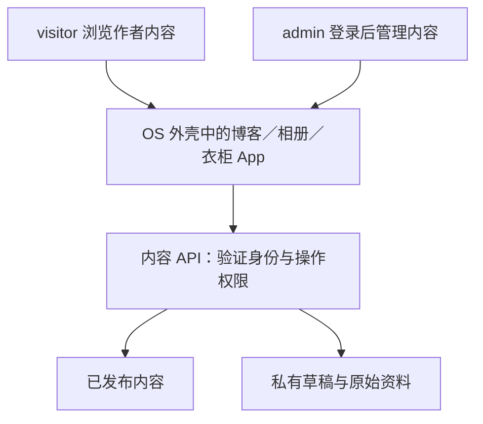

# 产品调研 Issue #1 评论归档

来源：https://github.com/Hi-Yincan/LifeOS/issues/1
采集日期：2026-10-16。最终状态：CLOSED / completed。最终决策以 R15 为准；历史报告保留当时措辞。

---

原始评论：https://github.com/Hi-Yincan/LifeOS/issues/1#issuecomment-6197932999

## R01｜调研结论、产品定位与研究边界

版本：v1.0 · 日期：2026-10-15 · 编制：Codex · 状态：调研初稿，待项目负责人评审。

### 核心结论

**建议将 LifeOS 定位为“以操作系统交互组织个人知识、作品与生活内容的网站”。** 桌面是入口，App 是领域组织单位，窗口提供探索和切换能力；文章、照片、项目等仍应能被直接打开、阅读和分享。这是本轮研究建议，尚未形成冻结的 PRD 或技术选型。

用户已经明确“个人博客也是操作系统”，并提出博客、相册、健康数据、项目展示。[概念阶段现有记录](https://github.com/Hi-Yincan/LifeOS/issues/2#issuecomment-6181132923)进一步覆盖系统化 Wiki、衣柜、日常／技术博客，以及位置、日程、状态和健康组成的 ContextOS。调研保留这一完整愿景，不擅自缩减成求职作品集。

### 为什么选这两个参考对象

| 对象 | 本轮研究的价值 | 对本项目的启发（分析） |
| --- | --- | --- |
| [daedalOS](https://dustinbrett.com/) | 浏览器桌面环境，现场观察到文件式博客、任务栏和多窗口；详见 R02、R06 | 借鉴统一的桌面／窗口／应用关系，以及扩展应用的组织方式 |
| [DhirajOS](https://dhiraj-os-rho.vercel.app/) | 个人作品集以 App 展示，现场观察到欢迎页、项目窗口、手机全屏面板；详见 R02、R06 | 借鉴首次访问引导、明确的内容入口和手机交互 |

二者是用户指定的定性样本，足以对照产品方向，但不能据此推导市场规模、行业排名或用户偏好。没有用 GitHub Star 数替代产品价值判断。

### 建议坚持的四个产品原则

1. **OS 体验服务于内容。** 访客既可以探索桌面，也应能从分享链接直达一篇文章或一个项目；首次访问不必先学会管理窗口。
2. **按内容领域设计 App。** 博客、相册、Wiki、衣柜、ContextOS 各有数据结构与浏览任务；不是给同一个页面换几个图标。
3. **同一份内容适配不同交互。** 桌面端可多窗口，手机端优先全屏阅读与清晰返回；不直接缩小桌面。
4. **个人展示与个人私有空间分别建模。** 对 ContextOS，先确定可公开字段，再决定展示形式与同步方式。

### 本轮回答与尚未回答的问题

| 研究问题 | 本轮结论 | 证据程度 |
| --- | --- | --- |
| OS 形式是否能承载个人内容？ | 两个参考站均有可运行实例，成立 | 实站观察＋源码；不代表本项目已验证 |
| 哪种交互更适合内容访问？ | 建议桌面探索与内容直达并存 | 对照分析，需原型验证 |
| 应该先做哪些 App？ | R03 给出候选优先级 | 产品建议，需确认内容储备与目标访客 |
| 能否全部放在 GitHub Pages？ | 公开静态内容适合；私有数据与持续同步需另评估 | 官方托管说明＋架构分析，见 R04 |
| 用户是否喜欢、是否愿意回访？ | 尚无证据 | 未访谈、未做可用性研究、没有流量数据 |

### 当前项目基线

本地工作区仅见空白 `index.html`，当前提交为 `efc0aef`；已有阶段 Issue #1—#6。本轮没有实现产品代码、选择框架、关闭阶段 Issue，或将建议标记为已批准需求。现有 Issue 的用户评论是需求输入，本报告是下一阶段的决策材料。

本轮为公开资料研究、源码定点核验与专家体验走查；完整方法、版本及限制见 R06。研究产出已形成，不等于阶段评审已经通过。


---

原始评论：https://github.com/Hi-Yincan/LifeOS/issues/1#issuecomment-6197933659

## R02｜参考产品对照与实测发现

版本：v1.0 · 日期：2026-10-15 · 状态：待评审。`O` 表示本轮实站观察，`S` 表示源码／文档核验；“建议”表示分析判断。

### 对照矩阵

| 维度 | daedalOS | DhirajOS | 对本项目的建议 |
| --- | --- | --- | --- |
| 首次进入 | 直接看到桌面，含 My PC、Blog Posts、视频和游戏入口（O01） | 开机流程有 Skip，随后欢迎窗口解释作者及主要入口（O04） | 用简短欢迎内容说明“我是谁、这里有什么”，开机演出可跳过 |
| 内容组织 | 双击 Blog Posts 进入文件列表，再双击 `.whtml` 文章进入 TinyMCE 窗口（O01） | Projects 单击打开项目 App，含分类、搜索、项目状态及详情入口（O04） | App 内采用领域导航，博客优先文章标题、摘要、分类与时间 |
| 窗口能力 | 观察到博客列表与文章两个窗口、任务栏入口；README 描述拖拽、缩放、状态保存（O01、S01） | 最大化／还原、最小化、快捷入口恢复已操作验证（O05） | 先定义打开、聚焦、最小化、关闭及返回行为，再增加装饰效果 |
| URL | 从桌面打开文章时地址仍为 `/`；另用 `/?url=/CREDITS.md` 成功直接打开 Markdown（O02、O03） | 桌面打开 Projects 时仍为 `/`；直接访问 `/projects` 能打开对应窗口并改变页面标题（O04、O06） | 必须分别定义深链接、复制链接、刷新恢复与浏览器前进／后退 |
| 手机形态 | 390×844 下仍呈现桌面图标和底部任务栏（O07） | 390×844 下 Projects 成为全屏面板，最大化按钮由手机交互取代，提供 Home 和关闭（O08） | 手机保留 App 心智，采用触控友好的启动器与单面板导航 |
| 博客集成 | 文件／文档应用承载文章（O01） | `/blog` 以 iframe 打开独立博客，同时提供 Open full application（O09、S06） | 比较原生内容与嵌入方式；长文阅读体验、分享和维护成本优先 |
| 扩展方式 | 应用目录配置组件、图标、窗口属性，使用动态导入（S02） | 内容数据、OS 组件、App 组件分层；窗口管理入口统一（S04、S05） | 建立 App 注册约定和稳定内容标识，具体技术方案交概念／计划阶段 |

### 三个值得直接带入概念评审的发现

**F01：内容直达与桌面探索需要同时成立。** daedalOS 有 query 加载入口；DhirajOS 有路径入口。因此不能把两者误写成“不支持深链接”。但本轮普通桌面点击都未同步当前地址，说明“有入口 URL”不能自动满足“复制地址栏即可分享当前内容”。DhirajOS 的桌面源码会拦截普通点击，再打开窗口，与观察一致。[S03、S04]

**F02：手机需要单独的交互定义。** DhirajOS 的手机窗口隐藏拖拽／缩放处理，显示 Home 操作；源码与本轮 390×844 观察一致。建议本项目同样为手机明确前台 App、返回路径、滚动和切换规则。daedalOS 本轮仅确认手机宽度下保留桌面形态，没有完成真机触控验证，不能据此判定其手机端不可用。[S05]

**F03：项目可信度应来自内容。** DhirajOS 的项目页显示运行状态、技术栈、介绍、源码与详情入口。本项目可以采用“问题—我的贡献—实现—结果—证据—当前状态”的项目说明结构。这里借鉴信息组织，不把对方的状态标记视为已独立验证的运行保证。[O04]

### 不建议在首版直接照搬的内容

以下是针对本项目的范围建议：完整虚拟文件系统、模拟器、任意网站浏览器、复杂终端与大量游戏，暂不作为发布前提；它们需要更多维护，却尚未与当前内容访问任务建立必要关系。复古视觉、壁纸、声音也应在概念阶段与作者气质、中文阅读和手机体验一起比较，不直接选定 Windows 95 或某种现成皮肤。

### 本报告的源码依据

- S01：[daedalOS README，固定版本](https://github.com/DustinBrett/daedalOS/blob/f017b393d4175eb396a741a7562299423843f1b1/README.md)
- S02：[daedalOS App 目录](https://github.com/DustinBrett/daedalOS/blob/f017b393d4175eb396a741a7562299423843f1b1/contexts/process/directory.ts)
- S03：[daedalOS URL 加载逻辑](https://github.com/DustinBrett/daedalOS/blob/f017b393d4175eb396a741a7562299423843f1b1/hooks/useUrlLoader.ts)
- S04：[DhirajOS 桌面入口](https://github.com/uppadadhiraj/dhiraj-os/blob/62c58e18bb0e114a79d9940d6770727e54dd8f4e/src/components/os/Desktop.tsx)
- S05：[DhirajOS 窗口](https://github.com/uppadadhiraj/dhiraj-os/blob/62c58e18bb0e114a79d9940d6770727e54dd8f4e/src/components/os/Window.tsx)／[窗口管理](https://github.com/uppadadhiraj/dhiraj-os/blob/62c58e18bb0e114a79d9940d6770727e54dd8f4e/src/components/os/WindowManager.tsx)
- S06：[DhirajOS 博客嵌入](https://github.com/uppadadhiraj/dhiraj-os/blob/62c58e18bb0e114a79d9940d6770727e54dd8f4e/src/components/apps/BlogApp.tsx)

O01—O09 的可复现操作及限制见 R06；公开部署与上述源码提交的对应关系未由部署流水线核验。


---

原始评论：https://github.com/Hi-Yincan/LifeOS/issues/1#issuecomment-6197934325

## R03｜访客任务、App 版图与首版范围建议

版本：v1.0 · 日期：2026-10-15 · 状态：需求假设，待概念阶段确认。

### 谁会来、为什么来

以下是基于用户愿景建立的角色假设，不是访谈结论；目前没有访客占比、活跃度或转化率数据。

| 角色假设 | 希望完成的任务 | 本产品需要提供的价值 | 待验证的问题 |
| --- | --- | --- | --- |
| 内容读者 | 从链接读文章、查知识、看照片 | 清晰内容、可检索、可分享、手机可读 | 最常看技术文章、生活记录，还是 Wiki？ |
| 朋友／熟人 | 了解近况、兴趣和生活 | 持续更新的个人表达与适度公开的状态 | 愿意公开到什么粒度？是否需要分人可见？ |
| 同行／潜在合作者 | 理解项目、判断能力、找到联系方式 | 项目证据、个人贡献、运行状态 | 项目展示是否是首版最重要入口？ |
| 作者本人 | 发布、维护、整理个人内容 | 低成本更新、统一组织、可持续运营 | 主要在 Markdown、Obsidian、相册服务还是后台写作？ |

### App 版图：完整愿景保留，发布顺序单独决策

来源：[用户已有 App 清单](https://github.com/Hi-Yincan/LifeOS/issues/2#issuecomment-6181132923)与本轮会话。下表优先级是建议，未使用缺乏数据支撑的精确评分。

| App／系统能力 | 核心内容与任务 | 建议批次 | 进入开发前必须澄清 |
| --- | --- | --- | --- |
| OS Shell | 桌面、启动器、窗口、任务栏、手机导航 | P0 基础 | 单击／双击、多实例、关闭与返回语义 |
| About／欢迎入口 | 自我介绍、核心 App、联系入口 | P0 | 首次访问目标与可公开联系方式 |
| 博客 | 技术／日常分类；列表、详情、标签与链接 | P0 | 内容来源、存量文章、URL 与发布工作流 |
| 项目展示 | 项目列表、详情、本人贡献与运行证据 | P0 候选 | 是否已有可公开项目材料；与博客谁优先 |
| 相册 | 相册集、照片详情、描述与浏览 | P1 | 照片量、图片存储、隐私与元数据处理 |
| 系统化 Wiki | 按知识域组织、目录、检索与关联 | P1 | 与技术博客边界、导入格式、更新方式 |
| 衣柜／穿搭 | 单品、搭配、日期或场景 | P2 | 面向访客展示还是个人管理；是否已有数据 |
| ContextOS 公开摘要 | 状态、粗粒度近况、经筛选的运动／健康摘要 | 独立概念验证 | 字段白名单、更新时间、有效期、撤回方式 |
| ContextOS 私有部分 | 精确位置、详细日程、体检与生化原始记录 | 独立议题 | 身份、权限、数据来源、存储与同步边界 |
| 全局搜索／个性设置 | 查找 App 与内容、主题／减少动效等 | 随内容量评估 | 搜索范围、中文检索、允许保存的偏好 |

P0/P1/P2 仅表示先后候选，不承诺工期。若首版主要目标是展示生活，相册可与项目展示交换顺序。建议先用少量真实内容打通一条完整链路，再扩展 App 数量；不以空图标数量作为阶段成果。

### 首版需要验证的四条端到端任务

1. **初访了解作者：** 进入首页 → 知道作者是谁 → 找到感兴趣的 App → 读到真实内容。
2. **内容分享：** 打开一篇文章／一个项目 → 获取内容链接 → 新会话打开 → 看到同一条内容 → 能回到列表或桌面。
3. **手机阅读：** 从分享链接进入 → 阅读与滚动 → 返回／切换 → 不依赖窗口拖动完成任务。
4. **作者发布：** 新增内容 → 预览 → 发布 → 直接链接有效 → 出错可回滚。此流程是作者工作流，不默认要求在网站里实现编辑后台。

### 从研究发现形成的候选需求

| 编号 | 候选需求 | 依据 | 建议验收场景（待 PRD 定稿） |
| --- | --- | --- | --- |
| REQ-01 | 同一 App 具有一致启动与窗口状态 | R02 的窗口观察 | 打开、聚焦、最小化、恢复、关闭不产生失控状态 |
| REQ-02 | 每个公开内容对象有稳定链接 | F01 | 复制、刷新、新会话、前进／后退均有明确结果 |
| REQ-03 | 手机采用可完成核心任务的独立布局 | F02 | 390px 宽下完成阅读和返回，无必要横向拖动 |
| REQ-04 | App 和内容来源解耦 | 作者维护任务 | 新增普通文章／项目不必修改窗口管理实现 |
| REQ-05 | 公开状态有来源时间和有效期 | ContextOS 愿景与风险分析 | 过期时显示“已过期／未更新”，不冒充实时状态 |
| REQ-06 | 公开产物只包含明确允许发布的数据 | ContextOS 愿景与风险分析 | 检查 HTML、JSON、图片和构建产物，无原始私有记录 |

这些编号供后续追踪使用；当前尚未创建实施 Issue，也未将其视为已批准的 Spec。


---

原始评论：https://github.com/Hi-Yincan/LifeOS/issues/1#issuecomment-6197935032

## R04｜可行性、产品约束与风险处置建议

版本：v1.0 · 日期：2026-10-15 · 状态：初步评估；不是最终架构或安全审计。

### 托管与技术路线的初步判断

GitHub 官方将 Pages 定义为发布 HTML、CSS、JavaScript 的静态托管服务。[官方说明](https://docs.github.com/en/pages/getting-started-with-github-pages/about-github-pages)

因此建议先区分两类需求：公开文章、项目和经过筛选的数据可以在构建时生成；私有健康记录、带权限的读取、实时同步等需要独立设计可信数据服务。仅从仓库命名不能确认项目必须使用 Pages，本轮也未核验当前发布配置。

| 路线 | 适用条件 | 主要代价／待验证点 | 本轮建议 |
| --- | --- | --- | --- |
| 构建适合本项目的轻量 OS Shell | 重心是作者内容、中文阅读和长期维护 | 窗口／路由／手机状态需要自行定义 | 优先进入原型比较，不立即选定框架 |
| 基于 daedalOS 深度定制 | 完整桌面与文件系统本身就是目标 | 要理解应用目录、文件约定、状态及众多依赖 | 做复用范围评估后再决定 |
| 基于 DhirajOS 改造 | 希望较快得到内容型 OS 交互 | 需调整个人内容结构、链接同步与部署方式 | 可参考结构，不假定复制后即可满足本项目 |

核验差异：daedalOS 配置明确有 `output: "export"`；DhirajOS 当前配置包含 `headers()`，没有该导出项，README 以 Vercel 为部署目标。因此不能仅凭“静态内容”就断言 DhirajOS 无需适配便可部署到 Pages。两者都没有在本轮执行构建或部署测试。[daedalOS 配置](https://github.com/DustinBrett/daedalOS/blob/f017b393d4175eb396a741a7562299423843f1b1/next.config.js)／[DhirajOS 配置](https://github.com/uppadadhiraj/dhiraj-os/blob/62c58e18bb0e114a79d9940d6770727e54dd8f4e/next.config.ts)

### ContextOS：先定义公开数据产品

用户明确包含健康、位置和日程，所以数据边界是本项目的核心产品问题。以下为设计建议，未评估或处理任何真实健康数据。

| 信息类型 | 建议的公开方式 | 不应默认进入公开产物的内容 |
| --- | --- | --- |
| 当前位置 | 作者主动选择的城市／区域，允许延迟 | 实时精确坐标、常驻地址和完整轨迹 |
| 日程／状态 | 忙碌、休息、学习等摘要，标注有效期 | 完整日历、他人信息和精确行程 |
| 运动／健康 | 作者明确选择的汇总指标，标注统计周期 | 体检原件、身份信息、完整生化数据和未经选择的记录 |
| 照片 | 作者选择的公开版本 | 位置元数据及未获准公开的第三方内容 |

建议形成“私有来源 → 字段筛选／必要转换 → 人工确认或明确规则 → 公开快照 → App 展示”的流程。隐藏图标、前端密码框或 `noindex` 不作为权限方案；首版可只展示手工维护的公开快照。私有空间、登录和自动同步应独立立项，避免让公开站点承担未经设计的数据访问职责。

### 风险登记

以下优先级是研究判断，尚无事故率或量化概率数据。

| 编号 | 风险与影响 | 优先级 | 建议处置／验证 |
| --- | --- | --- | --- |
| RISK-01 | 私有数据被打入公开资源，后续隐藏界面无法撤销已发布副本 | 高 | 先定字段白名单；发布前查验产物与数据来源 |
| RISK-02 | App 状态与 URL 不一致，分享／刷新后丢失内容位置 | 高 | 先写 URL 与历史记录契约，做直链、刷新和后退验收 |
| RISK-03 | 桌面操作在触屏不可完成，核心内容无法阅读 | 高 | 独立手机原型与真机任务测试 |
| RISK-04 | 动画、相册、嵌入 App 同时加载影响首次阅读 | 中高 | 首屏资源预算、按需加载、图片分级；受控条件下测量 |
| RISK-05 | 搜索入口只能发现外壳，难以发现文章／项目 | 中高 | 真实内容 URL、语义内容、标题／描述、可抓取链接；验证输出 HTML |
| RISK-06 | 数据或嵌入服务失效，页面空白或状态过期 | 中 | 显示更新时间、失败／空状态、外部打开入口或静态快照 |
| RISK-07 | App 增长超过维护能力，长期出现空内容和失效入口 | 中 | 每个 App 明确内容来源、维护方式与退役条件 |
| RISK-08 | 引入上游代码／素材后来源记录不完整 | 中 | 选型时记录具体文件、版本、依赖与授权材料，避免整站素材直接照搬 |

关于 RISK-05：Google 官方说明抓取与 JavaScript 渲染是不同步骤，并建议预渲染／服务端渲染、可发现链接、独立标题与规范 URL。此处据此提出产品约束，没有声称任一参考站实际排名差，也没有完成 SEO 审计。[Google JavaScript SEO 基础](https://developers.google.com/search/docs/crawling-indexing/javascript/javascript-seo-basics)

两个参考仓库的根 LICENSE 均标注 MIT；这只是本轮核验事实，不等于已经审查所有内置程序、图片、字体及第三方内容。[daedalOS LICENSE](https://github.com/DustinBrett/daedalOS/blob/f017b393d4175eb396a741a7562299423843f1b1/LICENSE)／[DhirajOS LICENSE](https://github.com/uppadadhiraj/dhiraj-os/blob/62c58e18bb0e114a79d9940d6770727e54dd8f4e/LICENSE)


---

原始评论：https://github.com/Hi-Yincan/LifeOS/issues/1#issuecomment-6197935771

## R05｜阶段交付、验证方案与决策留痕

版本：v1.0 · 日期：2026-10-15 · 状态：流程建议，待项目负责人评审。

### 与现有六阶段 Issue 对齐

| 阶段 | 输入 | 建议交付物 | 进入下一阶段的条件 |
| --- | --- | --- | --- |
| #1 产品调研 | 作者愿景、参考产品 | 本组 R01—R06 报告、证据、需求假设、风险和待决事项 | 负责人确认定位及研究限制；待验证问题有明确去向 |
| #2 概念阶段 | 经评审的研究结论 | PRD、App 信息架构、桌面／手机原型、关键流程、范围与非目标、数据公开策略 | 核心任务原型验证；首版范围与主要取舍确认 |
| #3 计划阶段 | 已确认 PRD | Spec、必要 ADR、内容准备清单、里程碑、依赖、实施 Issue 与验收计划 | 高风险技术验证完成，任务具备可执行验收条件 |
| #4 开发阶段 | 已批准的 Spec 与实施 Issue | 实现、预览、适当测试、PR 与变更记录 | 实现对齐验收条件，必要评审与检查通过 |
| #5 验证／交付发布 | 候选版本 | 功能／手机／键盘／内容／性能／公开数据检查、发布说明、回滚办法 | 发布条件达成，遗留问题有明确处置 |
| #6 生命周期 | 已发布产品与使用反馈 | 内容更新、缺陷管理、依赖维护、数据有效性巡检、后续需求 | 定期复盘，并将新需求带回概念／计划流程 |

这是对现有 Issue 的建议分工，不代表全部流程已建立。本轮只写入 #1；#2—#6 的原始内容及讨论保持原状。

### 推荐的可追溯链路

`研究证据 O/S → 发现 F → 候选需求 REQ → PRD 条目 → Spec／ADR → 实施 Issue → PR → 验收证据 → 发布记录`

例如：`O04＋O06＋S04 → F01 → REQ-02 → URL/导航规格 → 路由实施 Issue → 对应 PR → 新会话直链／刷新／后退记录`。后续每个实施 Issue 至少写清问题、上游来源、范围、非目标、验收场景、依赖；不只写“做博客 App”。

阶段 Issue 正文保持导航目录，详细报告、评审结论和变更说明追加评论。形成决定时记录：日期、状态、决策人、选项、依据、影响、关联条目；之后修改决定时追加变更理由，不静默抹掉历史。

### 下一阶段应验证的假设

建议先邀请 5 名目标访客进行探索性测试，覆盖内容读者、熟人和同行，并安排作者完成一次真实发布任务。该样本用于发现问题，不用于统计推断；当前尚未招募或测试。

| 假设 | 验证任务 | 建议通过条件（待确认） | 不通过时的方向 |
| --- | --- | --- | --- |
| H01：入口容易理解 | 首访后找指定类型文章／项目 | 至少 4/5 人无需口头指导找到；记录路径与耗时 | 调整欢迎页、图标命名和信息架构 |
| H02：OS 交互不妨碍阅读 | 桌面打开内容，最小化后找回 | 至少 4/5 人独立完成且说清所在位置 | 简化窗口状态和导航 |
| H03：手机能完成相同核心任务 | 手机打开分享链接、阅读、返回 | 至少 4/5 人独立完成；关键控件可达 | 调整全屏面板、返回和触控区域 |
| H04：内容可长期维护 | 作者发布一篇文章和一个项目 | 无需修改 OS Shell；记录操作步骤、耗时与障碍 | 优化内容模型与预览发布流程 |
| H05：公开边界明确 | 负责人检查 ContextOS 样例字段 | 每个公开字段有用途、粒度、来源、有效期和撤回方式 | 暂缓该数据源接入 |

建议价值指标是“核心内容任务完成率”和“作者完成一次内容更新的成本”；同时记录误操作与找不到入口的原因。停留时间、窗口数量和开机动画完成率不能单独证明成功。当前基线均未知，不填写虚构数据。性能预算应在确定目标设备、网络和内容样本后建立，当前不声称达到任何评分。

### 决策清单

| 编号 | 待决事项 | 当前建议 | 状态／负责角色 |
| --- | --- | --- | --- |
| D01 | 首版服务谁、最重要的三项任务是什么 | 内容读者与作者维护优先，兼顾个人展示 | 待项目负责人确认 |
| D02 | 首版 App 与真实内容样本 | Shell＋欢迎＋博客；项目／相册按材料成熟度选择 | 待项目负责人确认 |
| D03 | 视觉语言与交互取舍 | 比较两种概念原型，检验中文阅读与手机体验 | 待概念设计 |
| D04 | ContextOS 哪些字段公开 | 先人工筛选的公开摘要 | 待项目负责人确认 |
| D05 | 内容源、发布托管与代码复用 | 先验证维护流程与静态发布，再作选型 | 待计划阶段验证 |

### 本阶段完成情况

- [x] 已阅读全部阶段 Issue；保留 #2 的用户愿景。
- [x] 已比较两个指定参考产品，并记录实际操作与源码依据。
- [x] 已形成角色假设、App 版图、候选范围和主要风险。
- [x] 已提供验证计划、阶段交付建议及追溯方式。
- [ ] 项目负责人评审报告并确认 D01—D04 的处理方向。
- [ ] 下一阶段建立并批准 PRD／原型。

建议评审结论使用“通过／有条件通过／退回补充”，并说明条件。本轮不替负责人作出阶段通过决定，也不自动关闭 #1。


---

原始评论：https://github.com/Hi-Yincan/LifeOS/issues/1#issuecomment-6197936506

## R06｜研究方法、证据登记与局限

版本：v1.0 · 调研日期：2026-10-15 · 编制：Codex。

### 方法与范围

1. 读取本仓库 #1—#6 的正文和评论、本地代码基线；其中 #2 是已有产品构想的主要文字来源。
2. 使用 Chromium 浏览器实际打开两个指定站点，走查首次进入、内容访问、部分窗口操作、内容链接及手机布局。
3. 核对 README 与相关源码文件，固定源码提交；对托管、搜索发现性参考官方文档。
4. 将事实、观察、推断、建议和未知项分开记录，不将参考项目文档的全部能力视为本轮已测试能力。

桌面初始视口约 1512×774，窗口操作复核为 1440×900；手机使用 390×844 视口及触控仿真。没有使用真实手机，未模拟弱网，也未运行 Lighthouse 或完整自动化测试。移动端的自动化点击不能替代真实触摸手势结论。

### 版本基线

| 对象 | 本轮核对的源码版本 | 说明 |
| --- | --- | --- |
| daedalOS | [`f017b393d4175eb396a741a7562299423843f1b1`](https://github.com/DustinBrett/daedalOS/tree/f017b393d4175eb396a741a7562299423843f1b1)，提交日期 2026-10-10 | GitHub API 查询 main 得到；不是部署版本证明 |
| DhirajOS | [`62c58e18bb0e114a79d9940d6770727e54dd8f4e`](https://github.com/uppadadhiraj/dhiraj-os/tree/62c58e18bb0e114a79d9940d6770727e54dd8f4e)，提交日期 2026-10-01 | 同上 |
| 本项目 | 本地 `efc0aef` | 仅空白 HTML 页面；不等于远端发布状态已核验 |

实站部署可能独立更新。源码引用均使用固定提交链接；实站观察只对应本轮会话，不宣称两者完全同版。

### 实测证据与复现步骤

| ID | 入口与操作 | 本轮观察 | 解释边界 |
| --- | --- | --- | --- |
| O01 | [daedalOS 首页](https://dustinbrett.com/) → 双击 Blog Posts → 双击 Live Well, Live Twice.whtml | 文件列表与 TinyMCE 文章窗口打开，任务栏出现对应入口 | 确认访问链路，未审计所有文档格式与编辑能力 |
| O02 | O01 完成后读取地址栏 | 地址仍为站点根路径 | 不等于没有其他分享机制 |
| O03 | 直接访问 [CREDITS 参数链接](https://dustinbrett.com/?url=/CREDITS.md) | 打开 CREDITS.md 的 Marked 窗口，显示 Credits 内容 | 验证一个参数入口，不涵盖全部参数、异常路径 |
| O04 | [DhirajOS 首页](https://dhiraj-os-rho.vercel.app/) → 关闭 Welcome → 单击 Projects | 打开 Projects.exe，出现分类、搜索与项目卡片；地址仍为根路径 | 未逐一验证所有项目、外部 Demo 或搜索匹配质量 |
| O05 | `/projects` 桌面窗口 → 最大化 → 还原 → 最小化 → Open Projects 快捷入口 | 控件切换为 Restore，最小化后窗口隐藏，重新打开可见 | 本轮未执行拖拽边界、多窗口压力和完整键盘回归 |
| O06 | 直接访问 [DhirajOS Projects](https://dhiraj-os-rho.vercel.app/projects)，并在手机仿真下刷新 | 对应 App 打开，页面标题为 Projects · Dhiraj Reddy | 只覆盖 App 级入口；项目详情直链与浏览器历史未全面验证 |
| O07 | daedalOS 切为 390×844 并刷新 | 保留桌面图标与底部任务栏 | 单次自动化 click 只选中图标，不能据此推断真机单击／双击支持情况 |
| O08 | DhirajOS `/projects` 切为 390×844 并刷新 | 项目列表为全屏面板，显示 Home／关闭和底部任务栏；Home 隐藏窗口 | 只验证指定宽度与任务，不代表所有手机和浏览器通过 |
| O09 | 直接访问 [DhirajOS Blog](https://dhiraj-os-rho.vercel.app/blog) | 内嵌独立博客可见，有 Open full application 链接 | 未审计 iframe 内所有内容及其跨站兼容性 |

以上观察由浏览器语义快照、URL／可见状态读取以及桌面和手机截图交叉确认。截图仅用于本地核验，没有上传为 Issue 附件；复核以以上操作记录与可访问入口为准。

### 外部一手资料索引

- 两个项目的 README、应用目录、路由、窗口和博客组件：见 R02 的固定源码链接。
- [DhirajOS App 路由](https://github.com/uppadadhiraj/dhiraj-os/blob/62c58e18bb0e114a79d9940d6770727e54dd8f4e/src/app/%5Bapp%5D/page.tsx)与[项目路由](https://github.com/uppadadhiraj/dhiraj-os/blob/62c58e18bb0e114a79d9940d6770727e54dd8f4e/src/app/projects/%5Bslug%5D/page.tsx)：含静态参数生成、元信息和初始 App 目标；源码核验，不是完整路由实测。
- [DhirajOS SeoOutline](https://github.com/uppadadhiraj/dhiraj-os/blob/62c58e18bb0e114a79d9940d6770727e54dd8f4e/src/components/SeoOutline.tsx)：提供语义化介绍与项目／分区链接；不据此宣称搜索效果或无障碍合规。
- [GitHub Pages 官方说明](https://docs.github.com/en/pages/getting-started-with-github-pages/about-github-pages)：静态托管边界。
- [Google JavaScript SEO 官方说明](https://developers.google.com/search/docs/crawling-indexing/javascript/javascript-seo-basics)：抓取、渲染、链接及元信息建议。
- 两仓库构建配置和 LICENSE：见 R04 固定链接。

### 明确未完成的研究

没有真实用户访谈、受控对照试验、访问分析、市场规模估算、跨浏览器矩阵、屏幕阅读器审计、性能基准、全面安全／授权审查，也没有实际构建两个参考仓库。未对健康数据做医学解释。所有优先级、用户角色和首版建议都应在概念阶段结合作者内容储备进一步确认。

本轮结论适用于“明确产品方向与下一阶段输入”，不能替代需求批准或发布验收。后续补充证据应沿用 O/S/F/REQ 编号，并在新评论中记录修订原因与影响。


---

原始评论：https://github.com/Hi-Yincan/LifeOS/issues/1#issuecomment-6198424281

## R07｜扩大候选池：16 个 Web OS 的人气与维护筛选

版本：v1.1 · 数据采集：2026-10-15 UTC · 状态：选型调研完成，底座尚未批准。

**本轮修正研究目标：优先在成熟的现有 Web OS 上二开。** 上一版只研究两个指定样例，覆盖不足；R04 中“优先构建轻量 Shell”的建议不再作为当前选型方向。R07—R10 是现行选型依据，R01—R06 保留为前一轮研究记录。

### 候选池与筛选方法

从 GitHub 的 `topic:web-desktop`、Web operating system、macOS web、Windows React 搜索，以及 [awesome-web-desktops](https://github.com/syxanash/awesome-web-desktops) 目录交叉发现候选；剔除原生 OS、远程桌面客户端、仅 UI 组件库和不相关搜索命中，纳入 16 个可比较的产品／框架，较上轮新增 14 个。该清单不是全网穷举。

筛选顺序：①是否有适合二开的代码与授权依据；②维护是否持续；③是否有可扩展的 App／窗口机制；④能否承载本项目内容与部署方式；⑤社区规模与传播证据。**Star/Fork 用于发现候选和衡量关注积累，不单独决定底座。** React95 等组件库、ReactOS 等原生 OS 不作为“完整 Web OS 二开”的同类候选。

### GitHub 指标快照，按 Star 降序

Star、Fork、订阅者取仓库 API；订阅者使用 `subscribers_count`，不是与 Star 混淆的 `watchers_count`。近 90 天窗口为 2026-07-17 00:00 UTC 至本次采集时，统计默认分支可达提交，包含 merge、文档和自动化提交。日期链接指向本轮核对的具体提交。

| 产品／仓库 | Star | Fork | 订阅者 | 默认分支最后提交 | 90 天提交数 | 筛选结果（研究判断） |
| --- | ---: | ---: | ---: | --- | ---: | --- |
| [HeyPuter/puter](https://github.com/HeyPuter/puter) | 43,721 | 4,088 | 224 | [2026-10-15](https://github.com/HeyPuter/puter/commit/8faff74793a9358b51ecc04a61eacea6bd7a1c08) | 1,018 | 深入：完整云电脑；需服务端 |
| [DustinBrett/daedalOS](https://github.com/DustinBrett/daedalOS) | 13,057 | 1,201 | 117 | [2026-10-10](https://github.com/DustinBrett/daedalOS/commit/f017b393d4175eb396a741a7562299423843f1b1) | 107 | 深入：LifeOS 首选验证对象 |
| [blueedgetechno/win11React](https://github.com/blueedgetechno/win11React) | 9,655 | 1,260 | 11 | [2024-08-11](https://github.com/blueedgetechno/win11React/commit/afb02e797106c208314abbf837ec11bf50da9d62) | 0 | 退出主选：已归档 |
| [win12-online/win12](https://github.com/win12-online/win12) | 7,266 | 907 | 55 | [2026-10-14](https://github.com/win12-online/win12/commit/9de1990a79254e0febeff67d6cc5d1c5f133a9b8) | 106 | 条件候选：活跃、中文生态；手机和授权声明需处理 |
| [os-js/OS.js](https://github.com/os-js/OS.js) | 7,085 | 868 | 228 | [2022-09-16](https://github.com/os-js/OS.js/commit/0aa874455e1ca5a31e7be193b3be14080300c2c1) | 0 | 暂不主选：平台结构成熟，核心包也缺少近期活动 |
| [ShizukuIchi/winXP](https://github.com/ShizukuIchi/winXP) | 5,865 | 473 | 61 | [2023-11-18](https://github.com/ShizukuIchi/winXP/commit/856bb554b3667f62078010b4cee10cc2645761e1) | 0 | 视觉参考：长期未更新 |
| [vivek9patel/vivek9patel.github.io](https://github.com/vivek9patel/vivek9patel.github.io) | 4,325 | 695 | 34 | [2024-11-24](https://github.com/vivek9patel/vivek9patel.github.io/commit/c4f1eff15aaba964fb0ad807afb4e233c33364dd) | 0 | 作品集参考：长期未更新 |
| [tobychui/arozos](https://github.com/tobychui/arozos) | 3,002 | 227 | 55 | [2026-08-16](https://github.com/tobychui/arozos/commit/2ecbb06b4c6fccc55ff739ba414cee650b9f61ad) | 47 | 条件候选：偏私有云／NAS |
| [PuruVJ/macos-web](https://github.com/PuruVJ/macos-web) | 2,679 | 346 | 26 | [2026-07-05](https://github.com/PuruVJ/macos-web/commit/14204808226d67fce14924d0b2ea889c807f12a9) | 0 | 视觉备选：近 90 天无提交 |
| [1j01/98](https://github.com/1j01/98) | 1,433 | 221 | 24 | [2024-07-01](https://github.com/1j01/98/commit/5245105214cee90ab984fc15bece6c92db15ca7d) | 0 | 退出主选：README 明示尚未授权 |
| [PiyushSuthar/Windows-11-Web](https://github.com/PiyushSuthar/Windows-11-Web) | 598 | 81 | 7 | [2023-08-21](https://github.com/PiyushSuthar/Windows-11-Web/commit/29002d1a84537442d58b52e37d5a5eeb41741455) | 0 | 视觉参考：长期未更新 |
| [KilledByAPixel/OS13k](https://github.com/KilledByAPixel/OS13k) | 527 | 33 | 40 | [2022-11-22](https://github.com/KilledByAPixel/OS13k/commit/671972146c3dd20479e783d6992367bd861bf614) | 0 | 创意参考：主要面向小游戏／创意编程 |
| [royalknight56/vtron](https://github.com/royalknight56/vtron) | 446 | 46 | 6 | [2026-04-27](https://github.com/royalknight56/vtron/commit/a9017bb170844c2336c67bf8f11db119a4c49162) | 0 | Vue 备选：有注册 API，社区较小 |
| [OXOYO/X-WebDesktop-Vue](https://github.com/OXOYO/X-WebDesktop-Vue) | 438 | 131 | 29 | [2025-12-27](https://github.com/OXOYO/X-WebDesktop-Vue/commit/147336a1f9381e3761e4bbe5774ba0eafb0d0acd) | 0 | 暂不主选：近 90 天无提交，文档版本需核对 |
| [prozilla-os/ProzillaOS](https://github.com/prozilla-os/ProzillaOS) | 359 | 75 | 6 | [2026-06-20](https://github.com/prozilla-os/ProzillaOS/commit/c94470a868054b21acf9a8bb0b39fedc9a718591) | 0 | 深入：App 框架化较好，社区小且近期静止 |
| [uppadadhiraj/dhiraj-os](https://github.com/uppadadhiraj/dhiraj-os) | 0 | 0 | 0 | [2026-10-01](https://github.com/uppadadhiraj/dhiraj-os/commit/62c58e18bb0e114a79d9940d6770727e54dd8f4e) | 15 | 保留产品参考：尚无成熟社区证据 |

### 容易误判的五处信息

1. **Windows 12 已迁移。** [旧仓库 README](https://github.com/tjy-gitnub/win12/blob/e9ef4dd49c1feffdc3e0b90c707ec9534eb9caa1/README.md)指向 `win12-online/win12`。旧入口只有 13 Star／1 Fork，不能用旧入口指标代表产品；上表采用迁移后的主仓库。
2. **OS.js 不能只看主仓库。** 补查 [osjs-client](https://github.com/os-js/osjs-client/commit/12717e22f2a6c8ea2021afc302a91dd2c66f25cb) 与 [osjs-server](https://github.com/os-js/osjs-server/commit/f77358e6a3bef87c49483ba9260649e2f49ca77a)，最后默认分支提交分别为 2024-01-26、2024-01-09，近 90 天均为 0；因此不是仅凭主仓库 2022 年静止作判断。
3. **ArozOS 有活跃开发分支。** 默认分支最后提交为 2026-08-16，但 [`v3.0.4`](https://github.com/tobychui/arozos/commit/4eca386814a846bd33eba7536fa6fba045ca1095) 在 2026-10-15 仍更新接口选择和启动设置；近期已合并 PR 样本也有 9 月活动。不能将默认分支日期误写成整个项目最后维护日。
4. **最新提交不一定是功能更新。** daedalOS 的最新提交修改 IDEAS.md，但同日有 [可访问性与缺陷修复](https://github.com/DustinBrett/daedalOS/commit/7d8c7f1757ec73d491230d19a70eded12890b431)和测试修复；Win12 最新提交是 `.gitattributes`。报告不把最后 push 时间当作代码质量证明。
5. **公开源码不一定能直接作为开源底座。** [98.js README](https://github.com/1j01/98/blob/5245105214cee90ab984fc15bece6c92db15ca7d/README.md)明确说明尚未授权、仅公开源码，故本轮排除；OS.js API 的 `NOASSERTION` 则需读文件，根 [LICENSE](https://github.com/os-js/OS.js/blob/0aa874455e1ca5a31e7be193b3be14080300c2c1/LICENSE)实际标注 BSD 2-Clause。

### 维护深度与发布习惯

| 对象 | 提交作者样本 | 发布／协作证据 | 判断 |
| --- | --- | --- | --- |
| Puter | 最近 100 个窗口内提交，10 个作者标识 | [26.10 Release，2026-10-05](https://github.com/HeyPuter/puter/releases/tag/26.10)；最近 10 条已关闭 PR 样本均有 2026-10-13—15 合并记录 | 多人持续开发，但快速迭代也意味着跟随上游的成本 |
| daedalOS | 最近 100 个窗口内提交，1 个作者标识 | GitHub latest-release API 未返回正式 Release；有近期功能、修复与测试提交 | 维护活跃，但近期样本集中于单一作者；适合固定 SHA 管理升级 |
| Win12 Online | 最近 100 个窗口内提交，14 个作者标识 | 主仓库 latest-release API 未返回正式 Release；桌面版是另外的仓库 | 不能把 Tauri 桌面版发布号当作网页版本 |
| ArozOS | 窗口内 47 个默认分支提交，7 个作者标识 | API 返回正式 Release [v2.025，2025-12-11](https://github.com/tobychui/arozos/releases/tag/v2.025)，同时开发分支进入 v3 | 版本／分支选择必须显式确认 |
| ProzillaOS | 近 90 天为 0 | [prozilla-os@2.0.5，2026-05-25](https://github.com/prozilla-os/ProzillaOS/releases/tag/prozilla-os%402.0.5)；main 2026-06-20 仍有 Code Editor 功能提交 | 有包发布与扩展结构，不能称近期高活跃 |

作者样本是 GitHub login／提交作者名去重，可能包含机器人，不是完整贡献者人数。0 次近期提交不等于项目一定不可用。GitHub Release 缺失也不等于没有可用构建。

### 复核口径

公开 API：`GET /repos/{owner}/{repo}`、`/commits/{default_branch}`、`/commits?since=2026-07-17T00:00:00Z&until=2026-10-15T23:59:59Z`、`/releases/latest`、`/pulls?state=closed&sort=updated&direction=desc&per_page=10`。Puter、daedalOS、Win12 超过 100 个提交，另用 `per_page=1` 的 `Link rel=last` 核对数量，分别为 1,018、107、106。当前日期之后的新数据不属于此快照。

各行仓库和提交链接为一手证据入口；本表记录的是采集值，后续 GitHub 页面数字可能变化。未以 open issue 数或总 fork 数推导维护响应速度、实际部署数或安全程度。


---

原始评论：https://github.com/Hi-Yincan/LifeOS/issues/1#issuecomment-6198425016

## R08｜社区人气与社媒讨论：可核验信号

版本：v1.1 · 指标采集：2026-10-15 UTC · 状态：公开样本研究。

### 口径：分别观察关注积累、协作活动与社区传播

R07 的 Star／Fork／订阅者反映 GitHub 关注积累，近期提交／PR 反映开发活动；本篇补充 Hacker News 与 Reddit 的帖子分数、评论和发布时间。没有把这些不同单位相加为一个“人气总分”，也没有拿历史爆款代替当前活跃度。

### Hacker News：有明确产品对应关系的讨论样本

通过 HN Algolia 公开索引查找标题／URL，再核对项目域名或仓库地址。下表为本轮检出的代表性帖子，不是全量讨论统计；分数和评论数是采集时的值。

| 产品 | 帖子日期 | 分数 | 评论 | 一手讨论入口 |
| --- | --- | ---: | ---: | --- |
| Puter 开源发布 | 2024-03-04 | 1,274 | 319 | [HN #39597030](https://news.ycombinator.com/item?id=39597030) |
| Puter 早期产品讨论 | 2022-12-02 | 858 | 219 | [HN #33838179](https://news.ycombinator.com/item?id=33838179) |
| daedalOS | 2024-01-01 | 387 | 133 | [HN #38830132](https://news.ycombinator.com/item?id=38830132) |
| daedalOS 后续展示 | 2025-05-25 | 201 | 79 | [HN #44088777](https://news.ycombinator.com/item?id=44088777) |
| OS.js | 2023-08-25 | 284 | 180 | [HN #37257218](https://news.ycombinator.com/item?id=37257218) |
| winXP | 2020-10-31 | 582 | 148 | [HN #24954495](https://news.ycombinator.com/item?id=24954495) |
| win11React | 2021-09-21 | 4 | 0 | [HN #28601165](https://news.ycombinator.com/item?id=28601165)，链接指向 win11.blueedge.me |
| ArozOS | 2021-01-15 | 3 | 0 | [HN #25787508](https://news.ycombinator.com/item?id=25787508) |
| OS13k | 2020-08-16 | 7 | 1 | [HN #24178995](https://news.ycombinator.com/item?id=24178995) |

**解读：** Puter、daedalOS、OS.js、winXP 均有较明确的历史技术社区传播证据，但 OS.js／winXP 的近期维护弱于历史关注积累，不能只依据这些帖子选型。win11React 的 GitHub 关注很高而本轮 HN 样本较小，也说明单一平台不能代表全部社媒。

### 近期信号与历史信号分开

- Puter 生态的 [Node.js in the Browser](https://news.ycombinator.com/item?id=49200118) 帖子发布于 2026-08-06，采集时 6 分／0 评论；[3D Studio](https://news.ycombinator.com/item?id=50080367) 发布于 2026-10-13，7 分／0 评论。它们是生态项目传播，不能直接作为桌面产品使用量。
- daedalOS 仓库链接的 [FlyWire 果蝇演示](https://news.ycombinator.com/item?id=49396322) 发布于 2026-08-22，1 分／0 评论。可证明有近期展示，不能称近期高讨论度。
- 本轮按产品名与域名查询，没有检出能可靠对应 ProzillaOS、vtron、DhirajOS 的 HN 帖子；Win12 新仓库 URL 的精确查询也未命中。该结果只表示本轮检索覆盖有限，**不等于零用户或全网零讨论**。

### Reddit：补充不同社区的实际讨论

| 产品 | 社区／帖子日期 | 页面显示分数 | 页面显示评论数 | 来源 |
| --- | --- | ---: | ---: | --- |
| Puter 26.05 发布 | r/selfhosted · 2026-05-11 | 约 484 | 112 | [原帖](https://www.reddit.com/r/selfhosted/comments/1taacxr/puter_2605_opensource_selfhosted_internet_os_2/) |
| daedalOS 展示 | r/javascript · 2022-12-03 | 约 99 | 24 | [原帖](https://www.reddit.com/r/javascript/comments/zbjx30/daedalos_desktop_environment_in_the_browser/) |

以上打开原帖核验，日期取页面 `time datetime`，没有使用搜索摘要的“几年前”作日期；Reddit 分数可能浮动，故用“约”。两个帖子相隔多年，不能直接以分数比例判断当前受欢迎程度。Puter 标题自述的下载量、贡献者和用户规模未独立核验，本报告不将其列为已证实的采用指标。

### 对筛选的实际影响

| 维度 | 本轮最有说服力的信号 | 应如何使用 |
| --- | --- | --- |
| 社区规模 | Puter 在 GitHub 和已核验的 HN／Reddit 样本上均突出 | 提高长期生态候选优先级，同时评估部署复杂度 |
| 与 LifeOS 的相关传播 | daedalOS 的公开演示与个人站点持续存在 | 与活跃代码维护一起支持优先验证 |
| 历史名气但维护不足 | OS.js、winXP、归档的 win11React | 保留参考价值，不自动进入主选 |
| 小众但扩展结构合适 | ProzillaOS、vtron | 不能因 Star 少直接排除，也不能称已有大规模采用证明 |

本轮没有获得可横向比较的 MAU／DAU、访客留存、真实部署数、活跃 fork 数或独立贡献团队规模。X、Discord、QQ群、Bilibili 等部分项目存在渠道入口，但未完成可复核的跨项目量化，故不编造粉丝数、热度趋势或全网排名。HN 查询存在模糊匹配，已排除与产品无关的命中，例如 ArozOS 同作者的 Zoraxy、与 daedalOS 无关的 Daedalus 项目；搜索返回的 `nbHits` 没有当成讨论总量。


---

原始评论：https://github.com/Hi-Yincan/LifeOS/issues/1#issuecomment-6198425785

## R09｜二开底座短名单与推荐结论

版本：v1.1 · 日期：2026-10-15 · 状态：研究推荐，未冻结选型，未执行本地构建验收。

**针对“以 App 展示博客、相册、项目及个人状态”的当前目标，建议先验证 daedalOS；ProzillaOS 作为扩展结构更清晰的备选；若要把产品推进为带账户、云存储和应用服务的个人云电脑，则优先比较 Puter。** ArozOS 更适合私有 NAS／家庭服务器方向。该排序结合 R07 的维护证据、R08 的社区信号及下面的源码／文档核验，不是按 Star 直接取最大值。

### 短名单比较

| 候选 | 可复用的底座 | 自定义 App 入口 | 托管与运维 | 本项目主要二开负担 | 建议 |
| --- | --- | --- | --- | --- | --- |
| **daedalOS** | 桌面、任务栏、窗口、文件浏览、多种内容查看器 | App 目录注册 React 组件和窗口元信息 | 已有 Next 静态导出配置；选定 App 的额外依赖仍需查验 | 博客／项目内容模型、稳定 URL、手机交互、品牌与默认内容 | **LifeOS 公开展示场景首选验证** |
| **ProzillaOS** | React OS 组件、App 类、虚拟文件系统、常用应用 | 独立包＋自定义 App 文档＋示例；可组合桌面、任务栏、窗口视图 | 文档明确覆盖 GitHub Pages、Vercel、Cloudflare Pages | 内容发布、深链接契约、手机端完整任务；要承担较小社区风险 | **结构型备选** |
| **Puter** | 桌面、账户、存储、应用平台、服务端基础设施 | Web App／开发者平台；核心 Shell 与平台服务可二开 | 当前完整自托管方案为多服务部署 | 匿名访客入口、个人内容展示、公共／私有空间划分、运维与升级 | **完整云电脑路线首选** |
| **Win12 Online** | 中文桌面、窗口、文件界面及大量系统风格应用 | 源码中有应用实现；需自行评估抽取与注册边界 | 网页版有 GitHub Pages 在线演示；部分集成功能需单独核验 | 手机适配、内容导航、与系统 App 的耦合、素材与 README 附加声明 | **偏好现代 Windows／中文外观时的条件候选** |
| **ArozOS** | 多用户、文件存储、服务器／设备管理、桌面及移动入口 | 脚本 API、模块与子服务扩展 | Go 服务和存储环境；面向 NAS／自托管服务 | 匿名内容门户、公开与私有数据分离、部署维护、版本分支选择 | **私有个人云方向候选** |
| **vtron** | Vue 桌面、窗口、文件与插件机制 | `System`／`VtronComputer`／Vue App 注册，存在模板 | 浏览器核心与新增 NAS 扩展需区分 | 内容应用、跨设备导航、较小社区与升级验证 | **若明确选择 Vue，再进入复核** |

表中的成本是相对判断，没有虚构工期或人日。应用示例和测试文件存在，不等于已通过本项目测试。

### 1. 为什么 daedalOS 仍排在前面

本轮扩大范围后，它依然同时满足：较大的关注积累（13,057 Star）、近期持续提交、已运行的个人内容站，以及可以直接定制的完整 OS 外壳。源码的 [App 目录](https://github.com/DustinBrett/daedalOS/blob/f017b393d4175eb396a741a7562299423843f1b1/contexts/process/directory.ts)集中描述图标、组件、窗口属性及加载方式，[构建配置](https://github.com/DustinBrett/daedalOS/blob/f017b393d4175eb396a741a7562299423843f1b1/next.config.js)包含静态导出。适合保留底座，把本项目差异集中在 App 与内容层。

代价同样明确：这是完整且持续增长的桌面项目，包含大量可选程序；它的现成博客以文件／文档交互为主，不能直接替代本项目的博客信息架构。最近 100 个提交作者样本集中于一个人，跟随维护要靠固定版本和升级回归。上轮确认的 URL 同步、手机阅读问题仍需在二开中解决。

**建议方式：** 从固定 SHA 建立二开分支，保留 upstream 来源；先调整品牌、桌面入口和应用配置，新增 Blog／Projects 等 App。核心窗口管理尽量通过原有接口复用，确需修改时隔离成小补丁。先衡量不启用重型 App 后的加载与打包情况，再决定是否删除上游模块。

### 2. ProzillaOS：二开 API 更明确，但不能夸大成熟度

[自定义 App 指南](https://github.com/prozilla-os/ProzillaOS/blob/c94470a868054b21acf9a8bb0b39fedc9a718591/docs/src/guides/custom-app.md)明确使用 React 组件与 `App` 元信息注册；[作品集配置示例](https://github.com/prozilla-os/ProzillaOS/blob/c94470a868054b21acf9a8bb0b39fedc9a718591/examples/portfolio/src/config/apps.config.ts)以及[部署指南](https://github.com/prozilla-os/ProzillaOS/blob/c94470a868054b21acf9a8bb0b39fedc9a718591/docs/src/guides/self-hosting.md)提供可沿用路径。本轮实站双击 `Info.md`，成功在 Notes 窗口看到 Markdown；390×844 截图中正文可排布和阅读，但没有完成全部触控任务验证。

它只有 359 Star，近 90 天没有提交，因此定位为**小众但结构匹配的候选**。`main` 已有发布后功能，不能把 main 与 2.0.5 发布包视为完全相同；文档片段也要通过实际构建校验。已有 [lint／单元测试工作流](https://github.com/prozilla-os/ProzillaOS/blob/c94470a868054b21acf9a8bb0b39fedc9a718591/.github/workflows/checks.yml)，本轮未运行。

### 3. Puter：平台规模领先，运维成本也最高的一档

Puter 在本次候选中 Star/Fork 与多人近期维护信号最强，并有正式 Release。[当前自托管文档](https://github.com/HeyPuter/puter/blob/8faff74793a9358b51ecc04a61eacea6bd7a1c08/doc/self-hosting.md)列出 Puter、MariaDB、Valkey、DynamoDB-local、S3 兼容存储和 Caddy；需要配置域名／子域名与持久化。该部署方案与仅上传静态站点有明显差别。

本轮访问 Puter 首页看到产品介绍及注册／登录入口，没有创建账号、没有实际验证私有桌面或自托管部署。Puter.js 接入托管能力，与 fork／自托管整个 Puter 是两个决策，不能混写。对本项目，若只展示公开内容，平台能力可能超过需求；若 ContextOS 将包含账户、私有文件与云服务，则更值得投入验证。

### 4. Win12、ArozOS 的条件

- **Win12 Online：** 本轮能进入中文桌面并打开“此电脑”，但官方 [README](https://github.com/win12-online/win12/blob/9de1990a79254e0febeff67d6cc5d1c5f133a9b8/README.md)明确说移动端适配不完善；代码、媒体及文字分别有授权说明，另附额外条款。适合保留比较，不能仅凭 API 的 EPL-2.0 标签就视作所有二开问题已解决。选用前应记录采用的代码／素材及待澄清条款。
- **ArozOS：** [README](https://github.com/tobychui/arozos/blob/2ecbb06b4c6fccc55ff739ba414cee650b9f61ad/README.md)与[官网](https://os.aroz.org/)都指向文件存储／NAS／服务端场景；它不是简单的公开作品集模板。本轮只核验文档、官网和仓库活动，没有实际登录部署。若选用，应先确认 v2 Release 与活跃 v3 分支的取舍。
- **vtron：** [固定版本 README](https://github.com/royalknight56/vtron/blob/a9017bb170844c2336c67bf8f11db119a4c49162/README.md)提供 Vue App 注册步骤；近期代码还涉及 NAS 扩展。只有明确偏好 Vue，才值得进一步验证所需功能属于哪个包与版本。

### 授权信息作为选型输入

核验结果：daedalOS／ProzillaOS 为 MIT，Puter 为 AGPL-3.0，ArozOS 为 GPL-3.0，vtron 为 Apache-2.0；Win12 的代码／素材／附加声明需要分别读取。这里记录项目公开声明，不据此推导所有依赖、素材、商标均可按同一条件使用。对应 LICENSE／README 是后续复用清单的来源；本轮没有完成全面授权审查。


---

原始评论：https://github.com/Hi-Yincan/LifeOS/issues/1#issuecomment-6198426463

## R10｜二开落地范围、验证门槛与研究修订记录

版本：v1.1 · 日期：2026-10-15 · 状态：选型建议待评审；没有开始迁移或开发。

### 修订记录

| 事项 | 上一版 | 本轮修正 |
| --- | --- | --- |
| 研究目标 | 理解两个参考样例，偏向讨论产品形态 | **选择可直接二开的成熟 Web OS 底座** |
| 候选范围 | daedalOS、DhirajOS | 16 个产品／框架，并补查 OS.js 核心包及仓库迁移 |
| 主要证据 | 实站走查、源码片段 | 新增 Star/Fork/订阅者、90 天提交、Release、PR 样本、HN 与 Reddit |
| 实施方向 | R04 曾建议优先自建轻量 Shell | 撤回该优先建议；先验证 daedalOS，保留 ProzillaOS 与条件性的 Puter 路线 |
| DhirajOS 定位 | 主要对照样例 | 保留内容展示与手机交互参考；其 0 Star／0 Fork、2026-10-01 建仓，尚不足以证明社区成熟度 |

用户已明确“优先二开现有产品”，这属于本轮确定的方向约束；具体项目尚未选定。旧报告保留，目录将优先指向新选型报告，避免旧建议被误认为现行结论。

### 用现有底座实现你的内容版图

以下以首选验证对象 daedalOS 为例，是工作拆分建议，而非已实施结果。

| 本项目领域 | 复用底座 | 本项目仍需开发／整理 |
| --- | --- | --- |
| 桌面和应用启动 | 窗口、任务栏、桌面、启动器、应用注册 | 品牌、图标、默认 App、首次访问说明 |
| 博客 | 窗口／文档显示能力与 App 加载 | 日常／技术分类、列表、阅读视图、稳定链接、内容发布 |
| 相册 | 文件／照片查看与窗口能力 | 相册元信息、公开筛选、缩略图、浏览顺序、图片发布 |
| 项目展示 | App 容器与桌面入口 | 项目数据、贡献／结果说明、详情和演示链接 |
| Wiki | 文档显示、文件组织的可复用部分 | 知识域导航、关联链接、检索、导入规则 |
| 衣柜 | 通用 App 基础 | 单品／搭配数据模型及界面 |
| ContextOS | 展示容器 | 数据来源、公开字段、更新时间、有效期；私有能力另行设计 |

**二开复用的是系统基础设施，个人内容模型与内容生产流程仍需设计。** 现成 OS 有文件系统，不等于已经具备博客 CMS、相册管理或健康数据同步。

### 建议的选型验证，不再做空泛概念演示

先对 daedalOS 做一轮固定版本验证；只有出现阻碍或对扩展结构不满意时，再用同一任务比较 ProzillaOS。若确认接受长期服务器运维，再为 Puter 单独验证完整自托管。当前托管偏好尚未确认，因此两条路线均保留；不以未回复视为批准某条路线。

| 验证项 | 可评审交付物 | 通过条件 |
| --- | --- | --- |
| 上游能否稳定复现 | SHA／运行环境／锁文件、构建日志、可访问预览 | 干净环境按记录能构建运行；失败原因有证据 |
| 最小个人 App 能否接入 | 1 个 Blog App，含 1 篇真实中文文章；记录实际修改文件 | 使用现有 App／窗口接口完成；需修改核心的地方逐项解释 |
| 分享与内容到达 | 一篇文章和一个项目的链接测试记录 | 新会话、刷新、返回均有明确行为；匿名访客可读公开内容 |
| 桌面与手机能否完成任务 | 1440px 桌面、390px 手机与一次真机操作记录 | 阅读、关闭／返回、切换可完成；关键内容不会被窗口状态阻断 |
| 发布是否可维护 | 一次作者更新流程及预览／回滚记录 | 修改普通内容不需要改窗口管理代码 |
| 上游升级能否承受 | 自定义 App／配置清单、核心补丁清单、一次小范围升级演练 | 能说明冲突面及回归范围，不凭感觉承诺无缝升级 |
| 资源与数据边界 | 首屏资源记录、公开构建产物抽查 | 能区分必需加载与可选 App；私有数据未混入公开资源 |

验证产物进入 #2 的 PRD／原型和 #3 的选型 ADR／Spec；实施任务由确定的底座与内容范围派生。本轮尚未创建 fork、安装候选依赖、改仓库代码或发布新站点。

### 本轮新增的实测与证据范围

- **ProzillaOS：** 桌面入口 → 双击 Info.md → Notes 中看到 Markdown，已用截图确认；切到 390×844 后正文重新排布。没有据此声称完整手机体验通过。
- **Win12 Online：** 官方 boot 地址 → 模拟登录 → 关闭欢迎说明 → 双击“此电脑”，文件窗口打开；没有访问本机文件或接入外部账户。
- **Puter：** 只观察未登录首页，显示介绍及注册／登录；账户、云存储、SDK 能力依据固定源码和文档，未作为现场通过项。
- **ArozOS：** 阅读官网及源码说明、核查分支；没有操作私人服务器。
- **daedalOS／DhirajOS：** 延用 R06 已记录的实站操作，新增仓库指标与维护调查。

### 关键版本基线

| 候选 | 源码基线 |
| --- | --- |
| daedalOS | `f017b393d4175eb396a741a7562299423843f1b1` |
| ProzillaOS | `c94470a868054b21acf9a8bb0b39fedc9a718591` |
| Puter | `8faff74793a9358b51ecc04a61eacea6bd7a1c08` |
| Win12 Online | `9de1990a79254e0febeff67d6cc5d1c5f133a9b8` |
| ArozOS | master：`2ecbb06b4c6fccc55ff739ba414cee650b9f61ad`；活动分支另见 R07 |
| vtron | `a9017bb170844c2336c67bf8f11db119a4c49162` |

R07—R09 提供数据和原始链接；动态指标仅对采集日期有效。本轮没有执行候选本地构建、完整功能测试、性能基准或访客研究，因此推荐等级是“值得优先验证”，不能标为“生产验收通过”。阶段 Issue 保持开放。


---

原始评论：https://github.com/Hi-Yincan/LifeOS/issues/1#issuecomment-6199533220

## R11｜visitor／admin 与在线内容管理：Puter 优先级上调

版本：v1.2 · 日期：2026-10-15 · 状态：新增需求已记录；Puter 提升为首选验证对象，尚未冻结选型。

### 结论与变化原因

用户新增明确需求：visitor 与 admin 具有不同权限，同一个 App 面向 visitor 展示内容，面向 admin 提供管理功能，例如在衣柜 App 内维护单品与搭配。

据此，研究建议从 R09 的“公开个人内容站优先验证 daedalOS”调整为：**优先验证 Puter，为 LifeOS 提供身份与内容管理能力。** 选择权重现在应提高账户、共享数据、服务端权限、在线编辑与持久化能力的重要性。Puter 提供身份／存储／应用平台与 Worker 的组合，和该需求更匹配；这不代表现成衣柜、博客管理或业务角色权限已经具备。[平台介绍](https://github.com/HeyPuter/puter/blob/8faff74793a9358b51ecc04a61eacea6bd7a1c08/README.md)／[Worker 路由](https://docs.puter.com/Workers/router/)

### 产品角色建议

建议将 visitor／admin 建模为两种产品角色。admin 绑定作者自己的登录身份；visitor 可默认为未登录的访问者。如确有访客登录需求，可以映射为 visitor 角色，但不建议让所有人共享同一套 visitor 账号密码。“访客无需登录”目前是建议，尚待确认。

| 应用／操作 | visitor | admin |
| --- | --- | --- |
| 衣柜 | 浏览已公开单品与搭配 | 新增、编辑、上传图片、排序、发布／下架、删除 |
| 博客／Wiki | 阅读已发布内容 | 编辑、预览、保存草稿、发布、归档 |
| 相册 | 查看公开相册与图片 | 上传、分类、管理说明、选择公开范围 |
| 项目展示 | 查看公开项目、演示链接 | 编辑项目资料、证据与展示状态 |
| ContextOS | 只查看明确发布的状态／摘要 | 管理数据和公开字段；原始私有资料保持私有 |
| 应用入口 | 使用允许公开的 App | 配置 App 展示、管理内容及可见性 |

这张表是本项目提出的目标行为，不是 Puter 默认行为描述。内容管理员的业务角色，也应与维护 Puter 部署的系统管理权限分开定义。首版不需要因此引入复杂的多人团队权限系统。

### 必须理解的 Puter 数据边界

官方说明：默认 AppData 和 KV 在用户账户内按 App 隔离。**admin 在衣柜 App 写入自己的数据，visitor 打开同名 App 并不会自动看到这些数据。** 官方同时提供通过 Worker 访问所有者资源、形成集中共享后端的路径。[Security and Permissions](https://docs.puter.com/security/)

另外，`puter.perms` 的跨 App 数据授权解决的是“当前登录用户的另一个 App 数据是否可用”，不能直接替代本项目“管理员写、访客读”的跨用户内容策略。[跨 App 数据授权](https://docs.puter.com/Perms/appData/)

### 推荐的应用结构

保留同一个衣柜 App，按身份显示浏览视图或管理视图，共用内容模型；读写入口在服务端执行权限规则。展示目录和草稿区由作者管理，而非每个访客分别创建一份衣柜。


第一实现候选是 Puter Worker；如果选定自托管版本的 Worker 路径不满足需求，也可采用独立内容服务，再评估是否仍保留 Puter。Worker 官方区分所有者资源 `me.puter` 与调用者资源 `user.puter`，为“作者持有内容，访客读取公开部分”提供实现基础；仍需编写角色判断、发布规则与字段过滤。[Worker 上下文](https://docs.puter.com/Workers/router/)

建议每个 App 声明业务权限，例如 `wardrobe.readPublished`、`wardrobe.manage`、`wardrobe.publish`，统一映射到 visitor／admin。服务端依据验证后的身份确定权限，不信任前端传入的 `role=admin`；隐藏编辑按钮只负责界面体验。匿名与其他普通登录账户均不得修改作者衣柜，也不得通过详情 ID 或图片 URL 读取未公开数据。这些是本项目的设计要求。

### 技术配套判断

从已核查资料看，Puter 有开发文档、SDK、Worker 说明、测试与持续 Release，R07—R08 也记录了多人维护和社区讨论。因而用户对其技术配套较好的判断有依据。但我们没有核验到适用于本项目的响应时限／维护合同，不能将开源社区活跃等同于有保障的一对一技术支持。[官方仓库](https://github.com/HeyPuter/puter)／[发布记录](https://github.com/HeyPuter/puter/releases)

在线文档同时涉及 Puter.com 托管服务；选定自托管版本后，要实测 SDK 指向、登录、Worker、存储与图片访问能否在自己的部署中完成。当前 main 仍为 `8faff74793a9358b51ecc04a61eacea6bd7a1c08`。完整自托管需要服务器及其服务依赖，不能把整套 Puter 仅部署为 GitHub Pages 静态文件。[固定版本自托管文档](https://github.com/HeyPuter/puter/blob/8faff74793a9358b51ecc04a61eacea6bd7a1c08/doc/self-hosting.md)

### 选型验证应改为衣柜的真实权限闭环

1. visitor 新会话直接进入公共桌面，打开衣柜，看得到指定已发布内容；不能因公共读取被迫注册账户。
2. 作者登录后，在同一 App 新增衣物、上传图片、保存草稿；另一个访客会话仍看不到草稿和私有图片。
3. admin 发布后 visitor 能看到；下架后公共接口与图片访问按预定规则撤回，缓存策略有明确结果。
4. 匿名或普通登录用户直接调用写接口、伪造角色、枚举私有 ID，均无法越权；只隐藏按钮不算通过。
5. 注销后管理入口和访问资格消失；页面刷新、服务重启后已保存内容仍存在。
6. 确认公共桌面 App 白名单，以及访客上传、安装、系统设置等平台能力的限制可以落实；Puter 的临时账户不能直接假定等于本项目只读 visitor。

本轮仅更新研究结论和需求记录，没有部署 Puter、创建账号或开始 App 实现。后续 #2 的 PRD 应纳入角色矩阵、发布生命周期与公共桌面行为，#3 的 Spec 应纳入身份验证、数据归属和接口验收。通过上述闭环后再冻结 Puter 选型。


---

原始评论：https://github.com/Hi-Yincan/LifeOS/issues/1#issuecomment-6208431738

## R12｜本地部署反馈：LifeOS 展示场景与完整云电脑的边界

版本：v1.3 · 日期：2026-10-16 · 状态：产品边界修订；底座尚未冻结。

### 新证据与前版判断修正

项目负责人已在本地部署 Puter，反馈它更接近浏览器 OS，与“OS 样式的个人博客展示”存在偏差，并举出远程桌面等用不到的功能。此条是负责人的实际体验反馈；本轮助手没有检查该本地实例、部署版本或已启用的服务。

R11 因 visitor/admin 和在线管理需求提高了 Puter 优先级，但过度重视完整平台能力，对公开展示场景的适配权重不足。**本轮撤回“Puter 为首选验证对象”的优先建议：保留条件性评估，先以 LifeOS 展示场景的核心流程验证适配。** 账户权限仍是需求，但不要求账户、桌面和内容管理都由同一个完整 OS 提供。

Puter 官方定位覆盖工作、创作、娱乐及开发者平台，功能广度本来就是其目标；本地体验反映的是产品取舍差异，不据此判定 Puter 质量差。[官方 README](https://github.com/HeyPuter/puter/blob/main/README.md)

### 冻结产品边界的建议

建议将本项目的一句话定位写为：**访客通过 OS 桌面浏览作者的内容，作者登录后在相同 App 内管理内容。** 以下是待 PRD 确认的范围建议。

| 层次 | 本项目需要 | 暂不作为产品目标 |
| --- | --- | --- |
| 展示外壳 | 桌面图标、窗口、应用切换、手机阅读与导航 | 为每个访客提供一台可任意配置的云电脑 |
| 内容应用 | 博客、项目、相册、衣柜、Wiki、ContextOS 的指定公开内容 | 通用软件商店、远程桌面、完整办公软件集合 |
| 作者管理 | 登录、编辑、上传、草稿、发布／下架 | 让访客安装 App、管理系统或拥有独立个人网盘 |
| 平台服务 | 内容存储、图片服务、身份与业务权限 | 为尚未提出的通用云服务持续扩展后台 |

visitor 是否必须登录仍待确认；建议公开浏览默认无需登录。admin 应是作者内容管理角色，不要求其日常编辑时拥有全部系统运维权限。

### 架构建议：展示与内容管理可以分开复用



同一个衣柜 App，访客看到已发布单品，作者看到编辑与发布工具。前端负责窗口和视图，内容服务负责谁能读、谁能写以及哪些字段公开。需要的读写规则并不依赖一个完整的桌面操作系统。

因此可以同时复用现有桌面框架和成熟的内容管理／身份能力。具体内容服务尚未选型；不因为已经部署 Puter，就强制让后续所有 App 使用其存储模型。保留 Puter 作为后端也是可比较选项，但需说明实际复用价值与服务依赖，不能默认其一定比独立内容服务更省维护。

### 三条可执行路线

| 路线 | 适用条件 | 需要验证的代价 | 本轮建议 |
| --- | --- | --- | --- |
| Puter 配置与浅层定制 | 公共桌面、指定 App、访客权限能主要通过配置和清晰扩展接口完成 | 隐藏入口后是否仍带来不需要的交互、请求和服务依赖 | 保留为条件方案，先核对本地版本；不能假设已有某个配置开关 |
| Puter 深度裁剪 | 必须复用大量平台能力，且愿意长期维护核心改动 | 删除功能是否影响共享模块；上游更新冲突；部署依赖与回归范围 | 当前需求下不建议优先投入 |
| 模块化 OS 展示框架＋内容服务 | 核心是作者内容展示、少量管理入口与稳定分享 | 桌面框架成熟度、权限服务集成、手机体验和发布流程 | **推荐作为架构方向，以同一验收任务验证候选** |

“隐藏功能”“停止加载功能”“移除服务依赖”是不同层面的工作。仅隐藏远程桌面图标不能据此证明打包体积或运维成本下降；对当前部署的实际影响需要测量。本轮未执行性能测试或代码裁剪。

### 候选如何重新比较

- **ProzillaOS：** 官方 [App 指南](https://github.com/prozilla-os/ProzillaOS/blob/main/docs/src/guides/custom-app.md)提供自定义 App 注册和桌面／任务栏／窗口视图组合；[示例配置](https://github.com/prozilla-os/ProzillaOS/blob/main/examples/portfolio/src/config/apps.config.ts)通过 App 清单配置应用。适合验证“只带本项目 App”的组合方式，而非照搬完整演示站。它仍有 R07 已记录的小社区与近期维护不足问题，尚不能直接宣布替代成功。
- **daedalOS：** [应用目录](https://github.com/DustinBrett/daedalOS/blob/main/contexts/process/directory.ts)有现成注册机制，但也包含不少通用应用；同样需要比较定制边界，不能仅因它是个人网站就假定足够轻。
- **Puter：** 保留已部署实例作为实测样本，优先核查配置与扩展接口能否满足产品边界；广泛改动核心时，应重新评估收益。

以上链接于 2026-10-16 重新读取。前版 Star／Fork 数据仍是 2026-10-15 的快照，本轮没有刷新全部候选指标。产品适配判断应优先于关注度排名。

### 下一阶段的最小验收任务

以一份真实衣柜数据和一篇博客为共同样本，比较候选，而不是再浏览一遍默认桌面：

1. 新访客进入首页，只看到作者配置的 App 与公开内容，能直接打开内容链接。
2. 作者登录后，在原 App 内编辑、保存草稿并发布；访客只能看到已发布版本。
3. 手机能够完成浏览、返回和内容切换，不依赖拖动窗口。
4. 开发者能列出为此改动的配置、App 文件、核心补丁及运行服务；记录实际资源加载。
5. 若实现这三条用户流程需要广泛重写 OS 核心，或明显改变原产品主流程，则该底座不应继续仅因 Star／功能数量而优先。

这次部署已经为产品定位提供有效证据，不必把选型修订视为失败。下一阶段应将上述边界纳入 #2 的 PRD，再按同一任务做小范围验证；不立刻对 Puter 大删文件，也不未经验证就把另一整套 OS 冻结为底座。此处只记录方案与决策依据，本轮未修改任何部署或项目代码。


---

原始评论：https://github.com/Hi-Yincan/LifeOS/issues/1#issuecomment-6208862064

## R13｜本地实测：展示型 OS 的权限闭环与 Puter 适配边界

日期：2026-10-16。阶段：产品调研中的技术可行性验证。承接 R12；本报告为实际执行记录，不是最终技术栈决议或生产验收。

### 1. 结论

**建议优先推进“成熟 OS 外壳＋独立内容服务”，暂不把整套 Puter 作为默认底座。** 本轮已用发布版 `@prozilla-os/core@2.1.2` 跑通博客阅读、衣柜管理与独立访客访问，证明 visitor/admin 不必绑定某个云 OS 的账户体系。公开访客默认无需登录，服务端按内容状态和身份授权。

这不是宣布 ProzillaOS 最终胜出：它仍有包体、默认虚拟磁盘配置、窗口与 URL 协调等成本。Puter 保留为条件方案；若后续确实需要通用云文件、个人工作空间等能力，再重新评估整套系统的收益。现在不用因为已经部署了 Puter 就承担所有云电脑能力，也不需要立即删除现有部署。

### 2. 实验对象与范围

| 对象 | 本轮实际动作 | 不能据此宣称 |
| --- | --- | --- |
| 用户本地 Puter | 浏览器走查 `/` 与 `/desktop`；定点读源码；运行 19 项上游测试 | 完整 visitor/admin 衣柜已在 Puter 落地，或已测出全面改造工期 |
| 展示型原型 | core 2.1.2 + React 18.3.1 + Vite 7.3.2；只注册博客、衣柜；构建后运行；浏览器双会话和 390px 仿真 | 已决定生产框架，或框架内所有通用 OS 基础设施均已裁掉 |
| 内容服务夹具 | Node HTTP、本地文件存储、临时会话、服务端授权、草稿/发布快照、受控图片 | 生产 CMS、认证系统和全面安全审计已经完成 |

原型在仓库本地 `research/os-validation/`，与根目录站点隔离，未提交/推送，未修改根站点。使用合成文章、衣物、图片；没有导入真实相册、健康数据或用户凭证。没有修改现有 Puter 源码与配置；其已有的三个 package 文件变更保持原样。

### 3. 实测结果

| 场景 | 结果 | 证据 |
| --- | --- | --- |
| 未登录浏览 | 博客文章和已发布蓝色衬衫可读；未发布外套不在公开列表 | 浏览器 + API |
| 管理员新建、保存、上传 | 真实 UI 完成；独立访客请求草稿详情/图片均为 404 | `browser-lifecycle.json` |
| 发布 | 同一访客会话可读详情和图片，图片 HTTP 200；公开响应和页面无私有备注 | 同上 |
| 编辑已发布内容 | 保存第二版草稿后，编辑器显示新值，访客仍读第一版标题 | 同上 |
| 下架 | 公开列表移除；详情和原图片 URL 都返回 404 | 同上 |
| 注销 | 管理 UI 消失，管理 API 返回 401；旧 cookie 重放也被拒绝 | 浏览器 + 自动测试 |
| 越权 | 匿名请求、请求体/请求头伪造角色被拒绝；真实登录的普通 visitor 访问管理接口返回 403 | 自动测试 |
| 内容持久化 | 服务重启后内容保留，原会话失效 | 自动测试 |
| 网址与桌面 | 文章/衣物直接打开和刷新；衣物列表/详情前进后退；最大化、最小化恢复、关闭 | `browser-navigation.json` |
| 小屏 | 390×844 仿真完成登录、编辑保存、注销、返回、文章阅读；文档宽 390，衣柜内容区宽/scrollWidth 均为 379，无测得横向溢出 | `browser-mobile.json` |

**原型后端测试 11/11 通过，Puter 定点测试 19/19 通过。** 两组测试范围不同，不能合并成“所有产品测试通过”，也不能推断生产安全已验收。博客本轮只验证阅读，管理闭环由衣柜承担。

### 4. Puter 的修正认识

“Puter 功能过多，所以必须改核心才能精简”不准确。当前本地版本 `f9860b036bc34b540e5ffc16fc230671c069141d` 的官方架构文档和实现提供了 `app.recommended` 事件，扩展可替换推荐应用列表，包含空列表；Homepage 服务还提供 GUI 参数和脚本注入能力。

本轮运行的 `RecommendedAppsService.test.ts` 和 `HomepageController.test.ts` 共 19 项通过，验证了推荐列表及首页相关行为。测试使用 mock / 内存设施，没有操作现有实例的内容库。

但要区分三个层次：

1. **入口定制**：移除推荐入口、调整首页，有已有扩展点。
2. **功能/依赖裁剪**：入口消失不代表后端服务、维护成本同步消失；本轮未完成系统级裁剪验证。
3. **业务授权**：衣柜草稿、发布版本、私有图片和 admin 操作，需要内容规则；推荐列表和 OS 登录不能替代这些规则。

定点检查没有找到可直接套用的完整“匿名只读个人展示站”配置。`disable_user_signup` 会同时限制临时与永久注册并要求已有账户登录，不能直接等价于本项目所需访客体验。这是本轮检索与测试边界，不是断言 Puter 无法实现。

源码依据：[推荐服务](https://github.com/HeyPuter/puter/blob/f9860b036bc34b540e5ffc16fc230671c069141d/src/backend/services/apps/RecommendedAppsService.ts)、[架构文档](https://github.com/HeyPuter/puter/blob/f9860b036bc34b540e5ffc16fc230671c069141d/doc/architecture.md)、[首页服务](https://github.com/HeyPuter/puter/blob/f9860b036bc34b540e5ffc16fc230671c069141d/src/backend/services/homepage/PuterHomepageService.ts)、[首页控制器](https://github.com/HeyPuter/puter/blob/f9860b036bc34b540e5ffc16fc230671c069141d/src/backend/controllers/homepage/HomepageController.ts)。结论来自本地对应 commit 的实际文件与执行结果。

### 5. ProzillaOS 的实际成本

- **不是零适配。** 关闭默认 Documents/Pictures、保留默认 Desktop 时遇到初始化 `undefined.split`。使用公开 `loadData` 初始化接口创建最小桌面解决，未改上游代码。
- **窗口和网址不是天然统一。** 原型补了相同链接恢复最小化窗口、关闭后 URL 回桌面的适配；真实交互中发现并修复保存后表单显示旧值的问题。高级多窗口焦点和所有历史组合尚未穷尽。
- **未安装可选 App ≠ 核心已经很轻。** 主 JS 611,953 bytes，独立 gzip 估计 188,402 bytes；60 个 assets 合计 678,895 bytes，逐文件 gzip 合计 222,110 bytes。核心仍输出并加载若干命令模块；观测到 cat/echo/ls/pwd/nano 等 chunk。构建有 >500 kB 主 chunk 和部分未用皮肤字体路径警告。
- **没有做不公平性能排名。** 原型是生产构建，现有 Puter 是本地运行实例，两者未在相同条件下测量；上述数字仅用于暴露原型成本。

包来源：[ProzillaOS 官方仓库](https://github.com/prozilla-os/ProzillaOS/tree/main/packages/core)；本次实际依赖以本地 lockfile 的 `@prozilla-os/core@2.1.2` 为准，不能与前序报告的 umbrella 包版本混为一谈。

### 6. 可复核材料与复现

本地 `research/os-validation/` 含 `SPEC.md`、`README.md`、源码、lockfile、测试与 `evidence/`。后者记录 TAP、浏览器生命周期/导航/小屏 JSON、DOM 语义快照、构建体积和 Puter 测试摘要。未提交材料不伪装成可访问的 GitHub 文件链接。

```sh
cd research/os-validation
npm ci --ignore-scripts
npm run build
node tools/start-local.mjs
# 另一终端
npm test
```

本地预览 `http://127.0.0.1:4387`，独立访客用 `http://localhost:4387`。实验管理口令在被 gitignore 的 `.runtime/credentials.json`，不放进 Issue。服务只监听回环地址。

### 7. 验证限制与阶段结论

截图 API 多次超时，未得到可用截图；本轮采用真实点击/表单输入、语义快照、DOM 几何与 HTTP 响应记录。小屏是浏览器仿真，自动滚动曾超时，经定位后真实点击继续，**没有完成真机触控或完整视觉验收**。无障碍、SEO/社交分享、生产认证与 CMS、真实内容迁移、部署、备份、负载和全面安全审计均未完成。

下架验证的是后续服务端请求受控，不可能收回访客此前下载的图片；生产 CDN 缓存策略还需设计。

**研究判断：展示/管理分层已获得运行证据；“Puter 是 visitor/admin 需求的必然选择”没有成立。** 下一阶段 #2 应据此定义内容模型、App 权限和公开链接要求，再选择生产内容服务与最终外壳；Issue #1 保持开放，本轮不冻结架构，也不启动正式迁移。


---

原始评论：https://github.com/Hi-Yincan/LifeOS/issues/1#issuecomment-6209201748

## R14｜daedalOS 与 ProzillaOS：成熟度复核及验证优先级修正

日期：2026-10-16。关联 Issue #1，承接 R09、R12、R13。状态：研究判断，未冻结生产选型。

### 结论与前版修正

**可以用 daedalOS 二开，而且按目前需求和证据，应将它恢复为首选验证对象；ProzillaOS 为备选，Puter 为需要完整云电脑能力时的条件方案。**

R09 原本就推荐先验证 daedalOS。R13 选择 ProzillaOS 做原型，是因为其独立包、App 类和可组合视图方便隔离验证“OS 外壳＋内容服务”。这只能证明架构可行，不能证明 ProzillaOS 比 daedalOS 更成熟、更省维护。此前没有做对等集成验证，就让原型选择呈现为底座倾向，依据不足。

R13 的权限、发布与图片隔离验证仍有效；它们是独立内容服务的证据，不是 ProzillaOS 独占优势。无需因更换外壳而废弃这些研究成果。

### 1. 同时间点的维护证据

2026-10-16 从两者官方 GitHub API 重新获取；提交窗口为 2026-07-18 00:00 UTC 起至采集时，默认分支结果已分页，不是只看最近 100 条。

| 指标 | daedalOS | ProzillaOS | 解读 |
| --- | --- | --- | --- |
| Star / Fork | 13,056 / 1,201 | 359 / 75 | daedalOS 的关注与复用尝试积累明显更多；Fork 不等于成功生产部署 |
| 仓库创建 | 2020-08-09 | 2023-07-13 | daedalOS 历史更长；不能只凭年限推断代码质量 |
| 默认分支最新提交 | 2026-10-10 | 2026-06-20 | 当前维护连续性 daedalOS 更强；没有提交不等于已停止维护 |
| 近 90 天提交 | 107 | 0 | 同窗口、同分支口径 |
| 最新工作流 | Tests 成功，2026-10-10 | Run checks 成功，2026-06-20 | 都有质量检查；需进一步看覆盖内容 |
| 分发与升级 | 本次 Release API 返回空列表，适合固定 commit 跟进 | 有版本化包与 Release；最新列出的 umbrella Release 为 2.0.5 | ProzillaOS 的包式消费更清晰，但不抵消活动差异；core 2.1.2 与 umbrella 2.0.5 是不同包 |

维护风险也需保留：daedalOS 本窗口 107 次提交全部来自 DustinBrett，不能把高 Star 解释为多人团队保障。ProzillaOS contributors API 返回 8 人，但近期无提交，也不能仅按累计贡献者人数判定其维护更可靠。

数据来源：[daedalOS 仓库 API](https://api.github.com/repos/DustinBrett/daedalOS)、[ProzillaOS 仓库 API](https://api.github.com/repos/prozilla-os/ProzillaOS)、[daedalOS 窗口内提交](https://api.github.com/repos/DustinBrett/daedalOS/commits?since=2026-07-18T00%3A00%3A00Z&per_page=100)、[ProzillaOS 窗口内提交](https://api.github.com/repos/prozilla-os/ProzillaOS/commits?since=2026-07-18T00%3A00%3A00Z&per_page=100)。本地冻结快照：`research/framework-comparison/evidence-2026-10-16.json`。

### 2. daedalOS 的测试证据更贴近要复用的窗口底座

固定 SHA：`f017b393d4175eb396a741a7562299423843f1b1`。

检查了最新 [Tests 工作流实际执行记录](https://github.com/DustinBrett/daedalOS/actions/runs/38066476386)，确认安装依赖、Jest、构建、Oxlint 和 Playwright E2E 各步骤均成功，而不只是发现仓库里有测试文件。

[Playwright 配置](https://github.com/DustinBrett/daedalOS/blob/f017b393d4175eb396a741a7562299423843f1b1/playwright.config.ts)覆盖 Chromium、Firefox、WebKit；[窗口测试](https://github.com/DustinBrett/daedalOS/blob/f017b393d4175eb396a741a7562299423843f1b1/e2e/components/system/Window.spec.ts)包含最小化、最大化、小视口下窗口行为，另有键盘与可访问性测试。ProzillaOS 的 [checks](https://github.com/prozilla-os/ProzillaOS/blob/c94470a868054b21acf9a8bb0b39fedc9a718591/.github/workflows/checks.yml)主要执行包构建、lint 和单元测试。本次核验的工作流中，daedalOS 的浏览器端覆盖更直接对应本项目要复用的能力。

这是**上游 CI 证据**，不是我已经在本机完成 daedalOS 衣柜原型或证明所有浏览器/手机都无问题。工作流有重试配置，成功也不等于无偶发失败。

### 3. 二开接口核验：没有发现必须排除 daedalOS 的理由

| 本项目要求 | daedalOS 现有支撑 | 仍需要我们实现的部分 |
| --- | --- | --- |
| 博客、衣柜作为原生窗口 App | `contexts/process/directory.ts` 注册动态加载 React 组件、图标、标题、窗口尺寸；`RenderComponent` 将组件包进公共 Window | 新增内容 App 与品牌入口 |
| 同 App 的 visitor/admin 视图 | App 是 React 组件，可访问独立内容 API，不必依赖完整云 OS 账号 | 身份接入、管理视图；所有写入与私有读取由服务端授权 |
| 内容链接 | `useUrlLoader` 已支持 `?app=` / `?url=` 初始化打开应用 | 内容 ID、路径、前进后退及分享契约；不是已有完整博客路由 |
| 静态前端部署 | `next.config.js` 包含 `output: "export"` | 独立内容 API 的部署与认证；静态导出本身不提供管理后端 |
| 减少无关应用 | 应用目录使用动态 import，具备按应用拆分的入口 | 还需盘点开始菜单、文件关联、预加载、构建脚本和静态资源，实际测量裁剪效果 |

关键源码：[应用目录](https://github.com/DustinBrett/daedalOS/blob/f017b393d4175eb396a741a7562299423843f1b1/contexts/process/directory.ts)、[公共窗口包装](https://github.com/DustinBrett/daedalOS/blob/f017b393d4175eb396a741a7562299423843f1b1/components/system/Apps/RenderComponent.tsx)、[URL 加载器](https://github.com/DustinBrett/daedalOS/blob/f017b393d4175eb396a741a7562299423843f1b1/hooks/useUrlLoader.ts)、[构建配置](https://github.com/DustinBrett/daedalOS/blob/f017b393d4175eb396a741a7562299423843f1b1/next.config.js)。

特别注意：现有 `useUrlLoader` 只在初始加载执行，并对 `url` 做文件存在性或特定应用的外部 URL 检查。任意衣物 ID 不能假装成已有文件直接套用；需设计业务路由适配。不能把“已有 URL 参数”写成“内容深链接已经验收”。

### 4. 为什么还保留 ProzillaOS

它的独立 core 包、自定义 App 文档和可组合视图，让“在自己的项目中消费框架”更方便；daedalOS 更接近 fork 完整项目，在项目内部新增 App。前者在接口清晰度上有优势，后者在当前维护、窗口实现积累和上游浏览器回归证据上更有优势。

对于本项目明确提出的“在成熟产品上二开”，后面这些指标应比原型搭建便利性占更大权重。尚无对等运行数据证明 daedalOS 的包体、移动端或升级成本更差，因此不能用未经实测的成本判断把它降到备选。

### 5. 更新后的验证决策

1. **daedalOS：首选验证对象。** 固定上述 SHA，在独立实验目录复用既有合成数据与内容服务，用相同衣柜发布流程验证；保留上游来源与小范围适配。
2. **ProzillaOS：备选及现有可行性样机。** 保留 R13 证据，不继续因已写原型而默认扩展成正式产品。
3. **Puter：条件方案。** 只有明确要复用云文件、通用工作空间等平台能力时，再提高优先级。

daedalOS 下一轮验收门槛是实际构建运行、同 App 管理闭环、公开链接、390px 阅读和管理、无关应用加载量、核心改动清单。当前没有完成该本地集成，因此这里修正的是**验证优先级**，不是提前宣布最终选型或迁移完成。

本轮实际完成：官方指标刷新、完整窗口内提交计数、固定版本源码核验、上游 CI 步骤核验、选型依据纠偏与 Issue 留痕。没有修改 Puter 部署，也没有将研究原型替换为生产站点。


---

原始评论：https://github.com/Hi-Yincan/LifeOS/issues/1#issuecomment-6209307900

## R15｜产品调研收口与 daedalOS 选型决议

日期：2026-10-16。决议编号：D-001。状态：**已确认**。决策人：项目负责人；记录与整理：助手。

### 1. 已确认的决定

项目负责人明确指示：“我确定使用daedalOS做二开，产品调研先告一段落，你做好收尾”。据此：

- **本项目使用 daedalOS 作为二开底座。** 不再保持“首选验证对象、选型未冻结”的状态。
- **产品调研阶段收口，Issue #1 按 completed 关闭。** 后续进入 #2 概念阶段，先形成 PRD；本次收尾不启动正式开发或部署。
- ProzillaOS 保留为研究样机和历史对照，Puter 保留为历史候选；两者均不是当前产品底座，不继续进行并行选型。

本决议替代 R09–R14 中与最终底座选择相关的暂定优先级。既有事实、测试结果与局限继续保留，不删除或重写历史评论。

### 2. 产品定位与决策依据

产品是 **OS 样式的个人内容展示站**：博客、相册、衣柜、项目、Wiki、ContextOS 等以 App 形式承载；visitor 浏览作者允许公开的内容，admin 在相同应用中管理内容。目标不是给每位访客提供一台通用云电脑。

选型依据见 R07、R09、R12、R14：产品形态匹配、较长的实现与维护积累、窗口及 App 复用机制、上游浏览器测试证据，以及负责人最终取舍。R13 的 ProzillaOS 原型验证的是“展示外壳与内容管理分层”的可行性，不能作为 ProzillaOS 获选的依据。

已核验的 daedalOS 源码基线为 `f017b393d4175eb396a741a7562299423843f1b1`。这是后续建基线时的可追溯起点，**不表示已创建 fork、完成本地移植或承诺永不升级**；代码引入和版本更新方式在计划阶段落实。

### 3. 本阶段交付清单

| 交付 | 记录 | 状态 |
| --- | --- | --- |
| 产品边界、访客任务、App 版图 | R01–R06、R11–R12 | 已记录 |
| 扩展候选、Star/Fork、维护与社区证据 | R07–R09、R14 | 已记录，指标按采集日期解释 |
| 技术可行性样机与验证 | R13；本地 `research/os-validation/` | 已完成限定范围验证 |
| daedalOS 成熟度与接入边界复核 | R14；`research/framework-comparison/` | 已完成源码与上游 CI 核验 |
| 最终底座决策与阶段交接 | R15；#2 的 C01 | 本次收口记录 |

验证口径保持不变：原型后端测试 11/11 通过；本地 Puter 定点测试 19/19 通过；daedalOS 的成功构建、单元测试与 E2E 来自上游 CI 核验。**没有把前两组测试计作 daedalOS 本地集成验收。**

### 4. 移交概念／计划阶段的事项

| 事项 | 已有输入 | 后续产出 |
| --- | --- | --- |
| MVP 应用与内容模型 | #2、#7、#8、#9；R03/R11/R12 | 哪些 App 首发、各自内容字段、公开与管理任务；不把实验中的两个 App 直接当作已批准 MVP |
| 应用呈现方式 | #9 的原生／网页／套壳问题 | App 接入规范和外部内容边界 |
| visitor/admin 权限 | 同 App 分角色是已提出需求 | 逐 App／操作／字段的权限矩阵；访客是否登录及草稿/发布规则 |
| 内容服务与身份 | R13 分层可行性证据 | 生产存储、认证、媒体访问与发布方案；测试夹具不直接升级为生产 CMS |
| 公开链接与移动端 | daedalOS 已有初始 `app/url` 加载机制 | 内容深链接、历史导航、分享/SEO、小屏和无障碍验收标准 |
| 可复用模板 | #2 已提出“最好同时做一个模板，方便他人使用” | 明确个人站与模板的交付边界、配置项及默认示例内容 |
| 上游跟进与裁剪 | 固定 SHA、完整桌面项目的实现特点 | 来源与版本策略、改动边界、无关功能/资源清单及回归范围 |

应用候选还包括日常／技术博客、相册、穿搭、系统化 Wiki、项目展示、ContextOS、HealthOS 和会员订阅看板。它们是需求池，不在本次收尾中全部纳入首发承诺。

### 5. 保留的风险与验收边界

- daedalOS 近期维护集中于主要作者；高 Star 不能替代本项目的升级与回归安排。
- 内容路由、管理闭环、390px 任务、无关应用裁剪和资源开销还需要在 daedalOS 上实际验证。
- ProzillaOS 小屏记录是浏览器仿真；截图采集失败，未完成真机和完整视觉验收。无此证据时不宣布相应质量门槛通过。
- 健康、位置、日程等信息需在概念阶段明确公开范围；既有实验全部为合成数据，不能推断真实资料可以默认公开。
- SEO、生产认证/CMS、真实内容迁移、部署、备份与全面安全验收未完成，均不因调研 Issue 关闭而视为通过。

### 6. 归档与阶段状态

Issue #1 主体保留简洁目录，R01–R15 以评论承载报告；#2 接收交接清单。后续若出现足以影响底座选择的新约束，应另留变更记录，不静默改写本决议。

本地 `research/` 保留原型、锁定依赖、测试证据、成熟度快照和收尾文档；历史调研评论另存于 `research/archive/product-research.md`。本地研究材料尚未提交/推送，已发布的 Issue 评论是协作记录入口。

本轮启动的回环实验服务已停止，运行数据和实验口令仍在 gitignore 的 `.runtime/` 中；它们不进入报告或归档。现有 Puter 部署和根目录产品站点保持原状。

**阶段结论：产品调研已结束；daedalOS 选型已确认；下一阶段为 #2 概念／PRD。**
