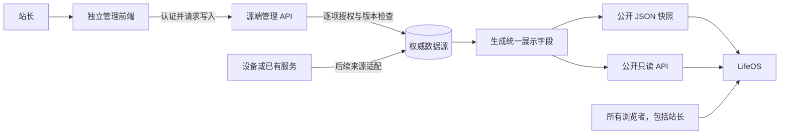

# LifeOS 信息源管理可行性报告

2026-10-18。关联作品集 #15、系统设置 #17、综合看板 #36、数据接入 #40。本文按用户最新决定先完成产品管理能力移除，再评估独立信息源管理；独立管理前端、认证服务、数据库和采集器均未开发。官方资料于同日核验。

## 1. 结论

**方案可行，适合 LifeOS 的定位。** LifeOS 专注统一展示；站长在独立应用中鉴权、编辑权威记录，LifeOS 从同一数据源读取统一的展示结果。站长打开 LifeOS 时与其他浏览者看到相同内容，源系统的登录状态不改变 LifeOS 响应。

建议采用“独立管理端 + 源端写 API + 版本化展示数据”的结构。管理端可以单独建立仓库、部署和使用，也可以先复用现有数据源的管理界面；它不依赖 LifeOS 窗口、进程或登录机制。接口契约是两者的连接点。

当前继续使用作品集静态快照与看板合成数据。接入真实来源时，先确定统一展示契约；会员适合从源端导出的 JSON 或只读 API 开始，监控和服务器数据则按实际刷新需求使用只读 API。具体管理产品与部署位置暂不选定。

## 2. 本轮实际删除与保留

已在干净产品集成基线 `e8f318935d1d11b9bb85c617239c7c1b121d3c4e` 完成以下实现；它延续此前全部看板 UI 修改。验证结果集中记录在 [本轮验收报告](../development/validation/lifeos-admin-removal.md)，不能由本报告的方案推定新系统已接入或已上线。

| 范围 | 实际结果 |
| --- | --- |
| 系统设置与共享客户端 | 删除维护折叠、密钥输入、登录/登出、管理员 Session、CSRF、会话探测和管理词条；保留语言、时区与只读内容请求，固定 GET 且 `credentials: "omit"` |
| Portfolio | 删除完整编辑器、创建、修改、上传、发布/下架、管理员读取与权限分支；保留概览、分类、搜索、详情、媒体、关于、双语与重试 |
| Dashboard | 删除隐藏编辑器、付款确认、续费修改、可见性/隐私预览模型、写入回调及编辑离开保护；保留全量合成记录、竖向导航、四项健康指标、90 日服务状态条、趋势与只读计算 |
| 现有本地内容服务 | 删除密钥生命周期、会话、管理 CRUD 与上传/发布；旧 `/api/session` 和 `/api/admin` 路径所有方法返回 404，不发会话 Cookie；公开读取不受旧 Cookie 或伪造身份影响 |
| 既有内容与文件 | 仅按白名单读取已发布作品和公开资料；不创建、修改、删除或迁移运行数据；旧草稿、私有备注与未发布媒体不会自动成为展示内容 |
| 普通 OS 能力 | 原生编辑器、文件工具、游戏、商店本机清单及 Messenger 本机资料编辑保留，它们不属于站点内容管理 |

本地服务无运行文件时从种子读取；已有运行文件时读取其已发布快照。Pages 构建仍只导出已提交的明确公开种子内容，不读取本地运行目录。此前研究原型和历史验收不重写，也不参与正式构建。

## 3. 共用数据源的结构



图中的快照与 API 是可选出口，可以只实现一种。权威数据源也可以按领域分别存在：会员记录在会员系统，服务健康来自监控系统，个人记录来自相应设备或记录系统。无需为了统一界面，把所有原始数据搬进一个数据库。

管理端维护权威记录，LifeOS 使用从这些记录派生的展示字段。源端需要的账户标识、私有备注、操作审计、凭据和未发布附件留在源端。展示列表、详情、统计和媒体必须来自同一份允许展示的数据，避免列表已移除而汇总或附件仍暴露旧内容。

两套前端可以采用完全不同的技术和视觉。建议共享 JSON Schema/OpenAPI 或轻量类型包，并维护兼容版本；LifeOS 不导入管理端组件、认证 SDK 的特权配置或数据库连接信息。后续管理界面重写时，只要公开契约兼容，LifeOS 可以保持不变。

## 4. 数据出口与管理产品的选择

GitHub Pages 托管静态 HTML、CSS 和 JavaScript，不能在站点内执行本项目的 Node 管理 API。LifeOS 留在 Pages 与外部信息源共用数据并不冲突，写服务需独立运行。[S1]

| 展示出口 | 更新方式 | 优点 | 需要承担的限制 |
| --- | --- | --- | --- |
| 随 LifeOS 构建的公开快照 | 内容提交、构建并发布后生效；当前作品集采用此方式 | 部署简单，展示不依赖实时源服务，可固定版本回退 | 更新需发布，不适合承诺实时监控 |
| 源端独立发布 JSON | 源端提交后生成完整快照，发布到独立静态位置；LifeOS 获取它 | 数据更新可脱离 OS 构建，接口容易保持稳定 | 需要源端发布流程、缓存策略和跨源读取配置；动态接入尚未实现 |
| 公开只读 API | 读取当前已发布记录或源端聚合结果 | 适合增量、分页、较短刷新周期及监控数据 | 需要服务可用性、限流、契约校验、缓存与故障处理 |

**建议：当前保留已有构建方式；未来会员源先提供独立 JSON 或简单 GET 接口，二者输出同一版本化契约。** 如果希望编辑后无须重建 OS，独立 JSON 发布或外部只读 API 都能满足结构上的要求，实际延迟取决于源端发布、缓存和客户端刷新设置，不能只凭“同一数据库”承诺即时同步。

| 管理实现候选 | 与本方案的关系 | 选择时需要核实 |
| --- | --- | --- |
| 既有会员/监控系统的管理界面 | 直接在来源维护，适配其 API 或导出；尽量减少重复录入 | 所选固定版本是否提供所需字段、稳定 ID、历史和受限读取；本轮没有验证具体连接器 |
| Directus 等独立内容管理系统 | 可用现成管理界面维护结构化记录；Directus 支持按操作、记录和字段配置权限，公共权限需明确配置 [S2] | 会员账期与付款语义是否需扩展；固定版本许可、部署、备份和升级。其研究时官方 main 已使用 MSCL-1.0-GPL，应复核最终版本条款，不沿用旧许可判断 [S3] |
| 独立定制前端 + Supabase 等数据平台 | 适合定制会员表单；数据库、身份和权限作为源系统基础设施 | 表与字段访问和 RLS 是否正确；公开 publishable key 不等于站长身份，secret/service-role 可绕过 RLS，不能交给浏览器 [S4] |
| 独立定制前端 + 自建 API/数据库 | 业务与部署控制最明确，可统一来源适配、版本和发布事务 | 自行承担认证、授权、存储、迁移、备份、审计和运行维护；仅在现成系统不满足时评估 |

没有必要在本轮确定供应商、购买服务或同时部署多套系统。上述是文档层面的可行性比较，未验证候选产品的性能、费用、地区连通性或实际迁移。

## 5. 会员实例：契约与更新过程

建议的公开响应结构如下，**仅用于说明，尚未实现 API**。以下记录完全虚构；最终字段需与来源能力核对。

```json
{
  "schemaVersion": 1,
  "snapshotId": "synthetic-0007",
  "sourceUpdatedAt": "2026-10-18T08:00:00Z",
  "generatedAt": "2026-10-18T08:01:00Z",
  "businessTimeZone": "Asia/Shanghai",
  "memberships": [
    {
      "id": "example-cloud",
      "name": { "zh": "示例云服务", "en": "Example cloud" },
      "category": "cloud",
      "planName": { "zh": "示例月付", "en": "Example monthly" },
      "amount": { "currency": "CNY", "minor": 2500 },
      "cycle": "monthly",
      "entitlement": { "status": "active", "endsOn": "2026-11-18" },
      "renewal": { "status": "cancelled", "autoRenew": "off", "nextChargeOn": null },
      "payments": [
        { "id": "example-payment-1", "amount": { "currency": "CNY", "minor": 2500 }, "paidAt": "2026-10-18T08:00:00Z" }
      ]
    }
  ]
}
```

| 对象/字段 | 约束与含义 |
| --- | --- |
| 稳定 ID | 会员、付款和来源分别有稳定标识；改名、翻译或排序不更换 ID |
| 金额 | `minor` 是币种最小单位的安全整数；币种明确。未知使用 `null`，免费使用 0。按币种分别汇总，不默认汇率换算；当前前端仍保持 CNY/EUR/JPY/USD 的已有范围 |
| 权益 | 表达是否仍可用及有效区间，取消续费可以仍有权益；不由付款计划自动推导 |
| 续费计划 | 预计日期、金额、自动续费和取消截止日期；未知明确保留，打开服务商页面不代表已完成操作 |
| 实际付款 | 只来自已确认源记录，有唯一事件 ID；计划到期不自动生成实付，重试不得重复计入 |
| 日期与时区 | 账单日期用日期字段并注明业务时区；实际发生时刻用带时区时间戳。按月排期需定义月末、闰日、账期锚点和夏令时语义 |
| 数据时间 | `sourceUpdatedAt` 是源数据变更，`generatedAt` 是快照生成；LifeOS 本地 `fetchedAt` 记录读取时刻。三者不能互相替代 |
| 版本 | `schemaVersion` 控制接口兼容，`snapshotId` 标识完整发布；编辑锁使用源端独立 revision，不把内部管理记录整体返回给 LifeOS |

当前前端使用 `startsAt/endsAt/nextAt` 等模拟字段，上例的日期字段需要未来适配器显式转换与契约升级，不能直接把不兼容的 JSON 填入现有类型。

建议的更新过程：

1. 站长在独立管理端登录，读取源记录与其 revision。
2. 修改续费计划时，源 API 验证身份、字段、版本及业务规则；通过后原子提交。使用 HTTP `If-Match` 时，条件失败按 412 处理；若采用应用 revision，则明确约定 409 等冲突响应。冲突不能静默覆盖。[S5]
3. 同一提交生成完整的展示版本。异步生成时，管理端区分“已保存”与“已发布到展示端”，记录失败与重试；快照指针只能指向已完成的版本。
4. LifeOS 在打开或刷新时获取公共响应并校验契约，整体切换到该快照；详情与汇总使用相同版本，避免半新半旧。
5. 付款确认使用独立事件和源端幂等标识；取消续费只改变计划。例中会员仍有效，已确认 25 元付款继续展示，预计未来续费不再累计。

## 6. 认证、跨源与故障边界

独立管理端需要真正的源端授权。每个非公开写端点都要验证身份及所操作对象；隐藏页面、浏览器按钮和 CORS 配置不能承担这项职责。OWASP 的 REST 指南要求在非公开端点实施访问控制。[S6]

建议管理端和管理 API 使用独立于 LifeOS 的 origin，并优先同源部署管理 UI/API。若采用 Cookie 会话，使用 host-only Cookie，避免将其作用域扩到整个父域，同时实施服务端 CSRF 防护；不同子域仍可能属于同一个 site，不能仅靠 SameSite 作为隔离边界。[S7] LifeOS 的公共读取不携带管理凭据，源端无论是否收到站长信息都返回同一展示字段。

LifeOS 跨域读取时，公共服务须配置实际可用的 CORS 响应，必要时暴露 ETag 等响应头。CORS 约束浏览器读取，公开数据仍可被脚本和其他客户端读取；它不能使已经公开的数据只对 LifeOS 可见。[S8]

| 场景 | 应约定的行为 |
| --- | --- |
| 源不可用、超时或限流 | 显示不可用，或展示标记为陈旧的上次公开快照；指数退避，遵守源的重试要求，不把失败转成零费用或“服务正常” |
| 快照没有变化 | 可用 ETag/`If-None-Match` 重新验证；304 只说明表示未变化，不能更新时间为新的测量时间 [S5] |
| 数据格式或版本不兼容 | 明确报错，不用部分字段拼出貌似成功的状态；可保留上次已验证快照并显示版本/时间 |
| 管理端并发修改或网络重试 | 原子版本检查和幂等操作；保留用户输入，提示重新加载/比较；不创建重复付款 |
| 修改已保存但导出失败 | 管理端显示保存成功、发布未完成；LifeOS 继续读取上一个完整版本，并显示其时间 |
| 源移除一条展示记录 | 下一发布版同时更新列表、详情、汇总和媒体引用，处理缓存失效；已被下载的副本无法远程收回 |
| 监测采集断流 | 来源陈旧与目标故障分开，缺测保留空值/断线，不能把旧正常当作当前健康 |

公开出口应定义缓存时间、客户端刷新间隔和最长可接受陈旧时间，之后才能给出传播上限。管理响应使用适当的禁止存储策略；`no-cache` 表示重用前验证，`no-store` 表示禁止缓存存储，两者语义不同。[S9] 具体参数留到来源与更新频率明确后确定，本轮不制造实时承诺。

## 7. 后续实施边界与验收建议

| 阶段 | 结果 | 验收重点 |
| --- | --- | --- |
| 本轮：取消 LifeOS 管理 | 当前源码只读，维护界面和已有管理服务退役；报告完成 | 两种构建、无管理请求/控件、身份不改变内容、旧接口不可用、运行数据不变，见独立验收记录 |
| 后续：确定一个来源 | 以会员为首个可选试点，明确采用已有系统、CMS 或独立实现 | 实际版本/API/许可、可导出性、字段与时区；此时再确认管理形式和运行位置 |
| 后续：建立源端管理与公开出口 | 鉴权编辑、持久化、版本与发布机制、公共 JSON/API | 未授权写入拒绝、冲突/幂等、字段白名单、恢复备份、发布失败和缓存传播 |
| 后续：LifeOS 读取适配 | 以公共契约替换 fixture，继续同一展示界面 | 匿名与站长浏览相同；没有管理凭据；跨源、版本、陈旧、断流和全量/增量一致性 |
| 后续：拓展其他来源 | 服务、主机、健康等按实际需求逐个接入 | 每个来源独立验收；不以一个会员示例推定全部采集器或 24h 服务完成 |

待后续阶段确定的事项包括首个真实数据源、管理端采用现成界面还是定制、部署位置、展示字段、更新时间和备份保留策略。用户已要求先处理当前前端，本轮将这些内容登记，不重复追问，不创建新后端，不迁移真实数据，不改域名或部署生产。

## 8. 官方资料与核验范围

以下资料为 2026-10-18 实际读取的官方正文。它们用于架构依据；本文的数据字段、推荐结构和分阶段路线是针对本项目的设计建议。

- [S1 GitHub Pages：静态托管说明](https://docs.github.com/en/pages/getting-started-with-github-pages/about-github-pages)
- [S2 Directus：Access Control](https://directus.io/docs/guides/auth/access-control)
- [S3 Directus 官方 main 许可证](https://raw.githubusercontent.com/directus/directus/main/license)；该 URL 随分支变化，选型必须固定发行版本再次核验。
- [S4 Supabase：API keys](https://supabase.com/docs/guides/api/api-keys)；[Row Level Security](https://supabase.com/docs/guides/database/postgres/row-level-security)
- [S5 RFC 9110：HTTP 条件请求](https://www.rfc-editor.org/rfc/rfc9110.html#section-13.1)
- [S6 OWASP：REST Security Cheat Sheet](https://cheatsheetseries.owasp.org/cheatsheets/REST_Security_Cheat_Sheet.html)
- [S7 MDN：Set-Cookie](https://developer.mozilla.org/en-US/docs/Web/HTTP/Reference/Headers/Set-Cookie)；[Site](https://developer.mozilla.org/en-US/docs/Glossary/Site)；[OWASP CSRF Prevention](https://cheatsheetseries.owasp.org/cheatsheets/Cross-Site_Request_Forgery_Prevention_Cheat_Sheet.html)
- [S8 MDN：CORS](https://developer.mozilla.org/en-US/docs/Web/HTTP/Guides/CORS)
- [S9 RFC 9111：Cache-Control](https://www.rfc-editor.org/rfc/rfc9111.html#section-5.2)

本轮没有部署这些候选系统、开展性能测试或核验用户实际数据源。已实现的只是本报告第二节的 LifeOS 功能移除及相应验证；源端方案仍待独立实施。
