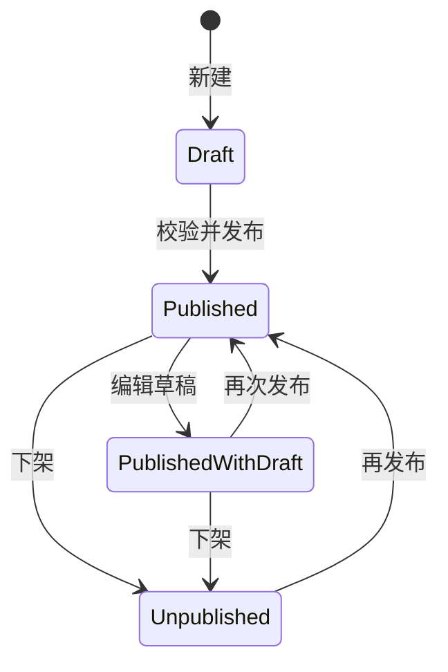

# 内容与权限模型

版本：1.0 概念交付稿。模型服务于单作者作品集，可扩展但不引入访客账户。

## 领域词汇

- **Project**：作品实体，有稳定 ID 和可分享标识，区分作者项目与参与贡献。
- **ProjectDraft**：管理中的最新草稿，可与已发布内容不同。
- **PublishedSnapshot**：明确发布时复制的公开快照；访客只读此版本。
- **Profile**：姓名、简介、教育/履历、联系方式；只存作者明确愿意公开的信息。
- **MediaAsset**：图片或视频资源，状态由草稿/发布引用与授权决定，文件名不是访问许可。
- **Visitor**：未获得作者管理会话的浏览者；能使用原 OS 工具，但无服务器内容写权限。
- **AdminSession**：通过单密钥校验得到的有期限作者会话，不创建用户账户。

## 数据字段

| 实体 | 字段 | 规则 |
| --- | --- | --- |
| Project | id、slug、kind、order、status、version、createdAt、updatedAt | kind 为 project/contribution；稳定 ID 不因标题翻译变化；排序是显式内容配置；版本用于并发检查 |
| ProjectTranslation | locale、title、summary、background、contribution、detail | 首发 zh-CN/en，数据库与字典按可扩展 locale 键组织；标题和摘要为发布必填，贡献说明无证据可留空 |
| ProjectLink | sourceUrl、websiteUrl、videoUrl、linkKind、lastCheckedAt | HTTPS 协议白名单；官网、文档、Demo 明确区分；有 URL 不等于可在线试用 |
| Technology | label、optional category | 基于实际项目资料；不自动变成个人技能评级 |
| MediaAsset | id、storageKey、mime、bytes、width/height、alt[locale]、ownerRef | 上传后私有；发布才允许公共读取；原始文件和转换版本分别记录 |
| Private metadata | privateNote、provenance、editor version | 不进入公开序列化白名单；provenance 可有单独公开来源字段，但不可全量透传管理记录 |
| ProfileTranslation | headline、bio、education、experience、contactLabels | 缺失经历不展示假占位，待补资料进入管理待办 |
| AdminSession | tokenHash、csrfSecret、createdAt、expiresAt、lastSeenAt、keyVersion | Token 只发 HttpOnly Cookie，服务端只保存哈希；轮换密钥能整体失效 |

## 状态与生命周期

草稿保存不改变公开快照；“已发布且有新草稿”需要明确展示。下架同时关闭公开详情与媒体的新请求，但无法收回访客已经下载的文件；生产缓存需有失效策略。首版以“下架”承担移除公开展示，不引入难以恢复的永久删除作为主要操作。

公开排序以已发布快照为准，编辑草稿排序须发布才生效。并发修改提交版本，版本过期返回 409，保留用户编辑内容并引导重新加载/比较，不静默覆盖。

个人资料使用同样的草稿与显式发布原则；正式管理界面需支持简介、教育/履历、联系方式的编辑。原型只证明项目编辑流程，资料目前来自 seed。生产作品媒体模型采用一张封面加可排序图片集合、可选视频外链及双语 alt；原型的单封面不作为生产媒体上限。

## 权限矩阵

| 能力 | Visitor | Admin |
| --- | --- | --- |
| 浏览已发布作品/公开简介 | 允许 | 允许 |
| 查看作品草稿、私有备注 | 拒绝 | 允许 |
| 读取未发布封面 | 拒绝 | 允许 |
| 新建、编辑、排序、上传 | 拒绝 | 允许 |
| 发布、下架 | 拒绝 | 允许，检查 CSRF/Origin/版本 |
| 使用原生编辑器、文件工具、游戏 | 允许 | 允许；不额外赋予后端写权限 |
| 改语言、布局等本地偏好 | 允许 | 允许；不改变任何内容授权 |
| 管理密钥生成/轮换 | 不在公开界面提供 | 运维途径配置；不以页面按钮泄露原密钥 |

## 建议接口契约

| 接口 | 功能 | 访问 |
| --- | --- | --- |
| GET /api/profile | 公开个人资料 | 公共，只含公开字段 |
| GET /api/projects | 已发布列表 | 公共，分页/筛选可逐步补齐 |
| GET /api/projects/:id | 已发布详情 | 公共，未发布/下架/不存在统一不可用 |
| GET /api/session | 当前管理状态与受保护写入校验信息 | 当前浏览器会话，禁止缓存 |
| POST /api/session | 单密钥登录 | 限速、Origin 检查；成功签发会话 |
| DELETE /api/session | 注销当前会话 | 已登录＋CSRF |
| GET/POST /api/admin/projects | 草稿列表/创建 | Admin |
| PATCH /api/admin/projects/:id | 更新草稿 | Admin＋版本 |
| POST .../:id/publish、unpublish | 发布/下架 | Admin＋版本 |
| POST .../:id/media | 上传/关联媒体 | Admin，真实内容检测 |
| /media/:id | 媒体访问 | 已发布引用或 Admin，不能只依靠猜不到 URL |

研究原型只实现单封面和视频外链，不代表生产媒体画廊、转换、持久对象存储和配置化个人资料编辑已经完成。生产接口需补审计、统一错误码、上传实际解码、尺寸约束、反向代理/HTTPS 设置和多实例会话；这些见计划任务。

## 密钥与故障处理

设置里的“站点维护”折叠区域放密钥入口；普通访客无需看到登录引导。密钥本身不保存在浏览器偏好中。验证失败显示统一提示并限速；会话失效则切回访客模式，正在编辑的内容先保留在内存以便重新验证后继续。

生产单密钥通过服务端 secret 配置，采用合适的密码派生算法存储验证值，HTTPS Cookie 设置 Secure/HttpOnly/SameSite；不将实验夹具中的本地口令文件发布。API 副本共享数据库中的会话记录，不能把实例内存作为唯一会话来源。

原型目前的固定期限内存会话仅验证流程；生产空闲超时、会话最长时长和轮换流程须作为安全实现任务测试。原生 App 导入或执行代码的同源风险单列门禁，详见 PRD。
