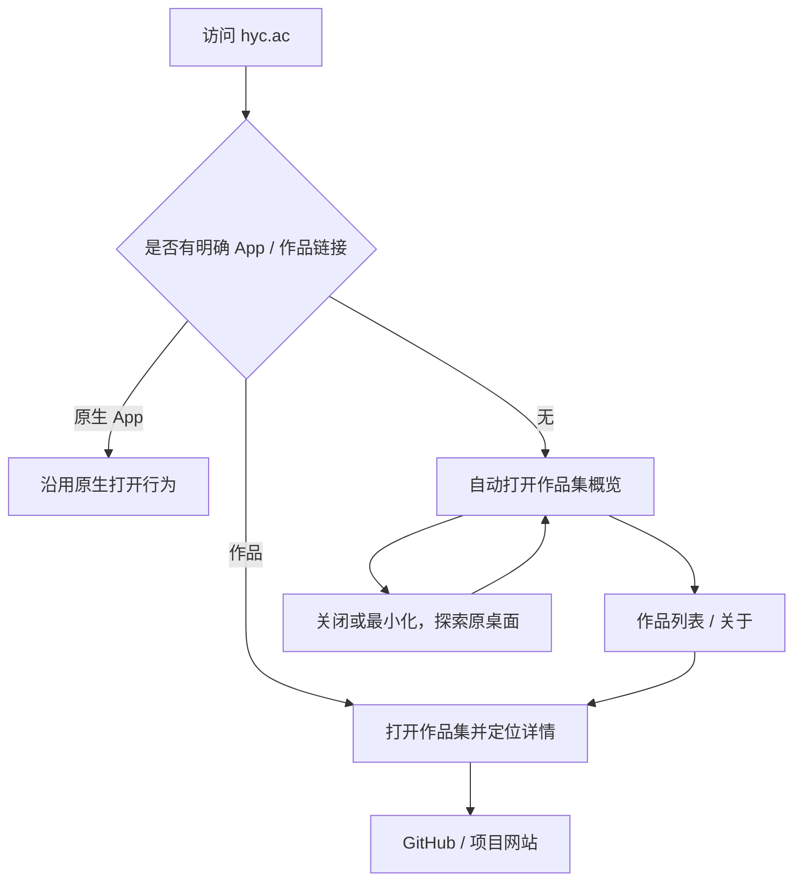
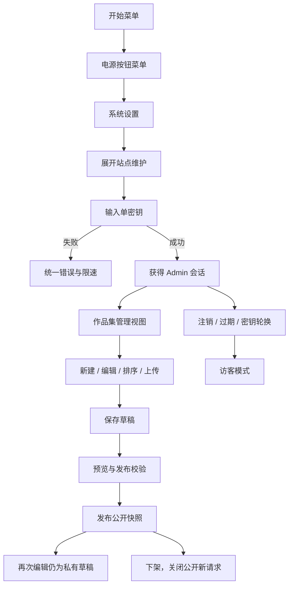

# 用户流程、状态与多端规则

版本：1.2 概念修订稿（2026-10-17）。关联 #14 多端适配、#13 多语言。

## 主要流程

## 页面与状态清单

| 页面 | 正常状态 | 必须定义的异常/边缘状态 |
| --- | --- | --- |
| 桌面/启动器 | 默认打开作品集，保留原 App | 首次内容服务离线仍能进入 OS；显式原生 App 链接不被作品集抢占；恢复最小化窗口 |
| 概览 | 简介、精选项目、源码入口 | 无已发布作品、内容加载中、内容服务失败；作者资料缺失不编造占位 |
| 列表 | 分类、搜索、排序 | 搜索无结果、语言切换、排序更新；访客不看到草稿数量或管理字段 |
| 详情 | 项目背景、贡献、媒体、技术与外链 | 不存在/未发布/已下架统一不可用；媒体损坏；网站链接不可用；翻译缺失回退提示 |
| 关于 | 已证实的简介、教育、技术与联系 | 未提供经历/技能评级时不显示虚构条目；联系链接为公开方式 |
| 设置 | 语言、地区信息、折叠维护入口 | 存储不可用时仅本次会话生效；自动语言匹配有回退；旧独立皮肤/设备模式偏好被清理 |
| 密钥入口 | 折叠维护区域、输入并进入管理 | 错误密钥、限速、连接失败、过期；不区分账号存在性，因为没有账号模型 |
| 编辑器 | 双语字段、媒体、排序、草稿与发布操作 | 必填错误、上传超限/格式不支持、未保存离开、并发冲突、会话失效、发布失败 |

## 路由与窗口

研究原型使用根页面 query：`?app=Portfolio`、`?app=Portfolio&view=projects`、`?app=Portfolio&project=aipm`。这是兼容当前静态托管与已有项目路径的基线，刷新不会要求 Pages 为新增作品动态重写路径。

路由是作品集内部导航的真实来源。前进/后退应还原内容；共享链接不包含管理密钥、私有字段或仅当前浏览器可读的 ID。原生 `app/url` 行为保留。公开作品被下架后，旧链接显示不可用，而不是重定向到某个其他作品误导访客。

桌面窗口可以独立最大化、最小化与关闭；恢复已打开的单例窗口必须同时恢复可见性和焦点。编辑器有未保存数据时，语言切换不触发离开提示，但关闭/转去其他内容需处理。浏览器刷新保护不能替代服务端草稿保存。

## 响应式：沿用 daedalOS 原项目

2026-10-17 负责人确认取消额外手机/平板适配。删除原 700px/coarse 检测与手动模式，没有独立触屏桌面、底部 OS 导航或强制全屏。保留原生桌面、Start Menu、任务栏、窗口标题栏与拖动/缩放/最大化。

当前固定基线由上游 `components/system/Window/functions.ts` 的 `minMaxSize` 等逻辑决定窗口尺寸；不覆盖 `.react-draggable`、原生窗口 transform 或任务栏显示。页面 viewport 声明也恢复上游值。作品集内部沿用同一内容结构，图文随窗口可用空间自然排列，必要时滚动。

原自制 App 的 device/theme/layout 偏好已经退役，迁移时仅保留有效语言选择。原生 App 的会话、文件系统与桌面偏好不清除。不同设备仍需验收，发现上游限制如实记录；不在本需求中另造系统交互。

## 多语言

首发简体中文和英文。偏好为 `auto / zh-CN / en`，以后扩展资源目录而不是散落条件字符串。优先级：手动选择 → 浏览器语言偏好列表 → 默认回退。语言选择不负责国内外服务器路由。

OS 公共文案、作品集文案、内容翻译分开管理。第一版覆盖作品集和设置、窗口操作、公共菜单；原生第三方 App 内部文案允许保留原语言并列出范围。研究原型已接入作品集/设置/窗口按钮，公共菜单完整字典仍属于正式实施任务，不能宣称全 OS 已翻译。

日期、数字格式使用标准国际化能力；时区与日程时间戳独立。翻译字段的缺失回退需告知用户，不能把一种语言内容无标识地冒充另一种。不会在访客每次进入时自动调用机器翻译。

## 代表性验证路径

1. 新访客→自动作品集→详情→源码/网站；关闭→原桌面→恢复作品集。
2. 中文/英文切换→刷新→偏好保持；自动模式重新匹配。
3. 开始→电源→系统设置→密钥→新建→双语编辑→保存→访客不可见→发布→访客可见→修改草稿不覆盖公开→下架。
4. 编辑未保存→切语言保留→关闭提示→取消仍保留；错误密钥和会话过期恢复。
5. 手机与平板横竖屏→详情→返回→启动原生 App→返回作品集；对照同一上游的窗口与任务栏表现，不额外改写触屏操作。
6. 旧直链在下架后不可访问；未知项目返回明确状态；搜索无结果、网络失败与加载状态各自有恢复入口。
