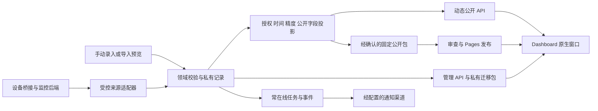

# 综合看板架构、领域与公开契约

2026-10-18 · 实施规格 v0.1。基于五份 [专题研究](README.md)，本文件收敛研究中的可选语义。本文规定行为与模块边界；实际 endpoint/type 名称在共享契约任务中统一提交后，其他模块再依赖，不能各自实现互不兼容的草案。

## 1. 运行边界

数据箭头不表示网络连接方向。采集与调度在页面关闭后需要独立进程；Pages 不运行此进程。当前 `server/service.mjs` 是本地 JSON/内存会话服务，只是本地验证入口；生产存储、会话、任务、媒体、网络与恢复由独立任务实现。

部署能力显式表达为 `local-management`、`static-public`、未来 `dynamic-public`。能力由服务配置声明，不由“请求某接口失败后换一个实现”猜测。生产配置错误应终止启动；静态客户端不发管理/session/私有源请求。

## 2. 模块边界与系统接入

| 模块 | 职责 | 不能承担 |
| --- | --- | --- |
| Dashboard App | 原生导航、视图、表单、公开/管理 DTO 显示 | 授权裁剪、保存第三方密钥、后台可靠任务 |
| 会话/系统设置 | 既有单密钥登录、语言/业务时区/默认币种、受信管理返回目标、来源凭据管理 | 为每个模块创建另一套账号或登录表单 |
| 领域服务 | 活动/会员/目录/主机记录、版本、业务校验、公开预览 | 把所有实体改成无约束 key/value 或 Portfolio Project |
| 公共投影 | 字段、对象、时间、精度、聚合和出口授权 | 通过前端隐藏替代访问控制 |
| 适配器 | 固定来源/版本、能力声明、协议校验、时间/单位映射、分页/去重 | 任意 URL 代理、远程控制、偷偷换到未验证接口 |
| 仓储/任务 | 持久化、迁移、检查点、幂等、保留/删除、运行恢复 | 从旧原型或活动 runtime 自动导入真实数据 |
| 导出/迁移 | 用途标记、白名单、版本与恢复；衔接 #31 | 将私有备份当成可发布 seed |

进程注册、组件动态导入、商店双语描述和应用软件归类、开始菜单、可选单一桌面入口、图标、专属深链接、Settings 登录返回目标各有唯一系统集成写入者。通用 `?app=` 已存在；Portfolio 的 `view/project` 路由保持自己的语义，Dashboard 使用独立参数并仅引用获准实体。

应用内部使用现有 Surface、StyledNavigation、StyledAddressBar、StyledStatusBar、Button、ScrollBars 与主题；样式限制在 Dashboard 根区域。公共语言/会话可从现有 LifeOS context 逐步抽出，只有确实被两个应用使用的能力才共享。不给未接入模块填充假数据以完成截图。

业务编辑器直接提供“公开范围/预览/发布”等动作，符合用户逐项控制需求。全局配置与连接器凭据在系统设置；Dashboard 不新增通用设置齿轮。401会话过期时清除私有查询/图表缓存，暂停私有内容显示与写入；未保存草稿仅保留在隔离编辑内存，重新验证后可继续，不写入localStorage。显式注销或关闭先走未保存保护，经用户确认处理后才丢弃编辑内存，不能把会话过期直接丢稿作为正确行为。

## 3. 领域实体与共有元数据

| 实体 | 关键字段/关系 | 不变量 |
| --- | --- | --- |
| DashboardConfig | schemaVersion、version、模块顺序、公开模块标题 | 管理配置与公开 DTO 不共用原始对象 |
| DataSource | 私有 sourceId、adapterKind/version、endpoint/secretRef、能力、周期、来源时区、游标 | secretRef 不对访客输出；连接器身份限单个来源/范围 |
| SourceCapability | current/history/incidents、可靠测量时间、分页、原分辨率、单位/聚合类型 | 能力不足就不提供对应操作，不合成历史 |
| Observation | sourceRecordId、metricId、value/unit、periodStart/end、observedAt、receivedAt、revision、quality | 实际值0与缺失/未知/不支持不同；修订幂等 |
| Activity/Schedule/Location | 起止/有效期、来源、公开摘要；日程UID/实例；定位精度 | 私有标题/会议地址/精确坐标与公开说明分离 |
| HealthSample/ExamRecord | 指标、值/类别、单位、原始区间/报告、左右眼/组合项、来源参考范围 | 不用单个数值表达全部检查；附件单独授权 |
| Membership/Entitlement | 稳定会员ID、套餐、有效期/试用与不确定性 | 权益不由是否还计划扣款决定 |
| RenewalPlan/Payment/Decision | 周期锚点、未来价格、自动扣款三态、计划状态；实付；处理结果 | 日期推进不产生付款；打开管理页不确认取消 |
| Service/MonitorBinding | 名称/公开URL、provider+monitorId、探测方法/位置、可选hostId | 服务入口与监测目标、主机不是同一个URL/实体 |
| Host/ResourceSample | 私有来源映射、publicId/别名、CPU分母、内存/磁盘/网络、分辨率 | 网络速率与累计量不同；counter reset不得产生负值/假峰 |
| PublicationPolicy | 模块/对象/指标、enabled、字段、时间模式/窗口/延迟、精度、policyVersion | 上级关闭为上限；新增字段/指标默认私有 |
| PublicProjection | schemaVersion、policyVersion、允许数据、可公开的来源/时间元数据 | 所有出口来自同一规则版本和允许集合 |

sourceId + sourceRecordId 标识来源记录，revision 明确修订。同一记录重试是幂等更新，不能将 revision 简单加入主键导致每次修订都新增累计量。只有没有原生 ID 的来源才使用已明确的复合键，重复冲突要可见。来源删除、本地删除、取消公开、停止采集是四种操作；本地删除不默认反向删除源设备。采用 tombstone 或明确排除规则，防止下次同步无提示复活已删记录。

时间元数据分别为：`observedAt`（测量，可空）、`sourceUpdatedAt`（源快照，可空）、`receivedAt/fetchedAt`（进入服务/抓取）、`generatedAt`（投影生成）。前端不能把后两者标为“刚刚测量”。来源时间与私有数量也可能泄露活动，只输出允许公开部分的元数据。

`freshness = fresh | stale | unknown | unavailable`，`quality = valid | missing | invalid | unsupported | partial`。服务领域保留 `up | down | pending | maintenance | unknown`；多检查组合按明确规则产生 `degraded`。主机在线是来源连接状态，不是业务健康。计算陈旧阈值要考虑采样、上报、持久化、缓存与业务时效；不能将源请求成功或全站60秒常量当成新鲜保证。

## 4. 公开时间规则

策略使用作者选择的 IANA `policyTimeZone` 与服务端可信时钟；语言、访客时区和客户端修改时间不影响授权。保存时区前真实敏感数据不能按浏览器默认时区自动发布。测试使用合成 UTC、Asia/Shanghai 和 America/New_York，不能将测试时区写为作者实际偏好。

### 日历模式（个人日级视图）

设服务端当前时刻为 N；T 为 N 在策略时区中的日期；延迟 D 为非负整数个日历日；允许的最新日期 L = T − D。

- D=0：截止 C=N，今日是未完成日；不能公开未来测量。
- D≥1：截止 C 为 L 次日当地00:00转UTC。“不展示今日”等同 D=1，不能称为“已经过24小时”。
- 展示 H=1或3个日历日：from 为 L−(H−1) 当地00:00；窗口为 `[from,C)`。
- 展示1个日历月：from 为 C 在策略时区回退1个日历月，同一时间并对月末截断；不是固定30×24h。
- 全部：from无下限，仍受截止、实际保留和其他权限限制。关闭：返回空投影且不泄露隐藏数量。

日界线统一取目标当地日期的首个真实时刻；午夜重复时取较早UTC，午夜不存在时取该日首个有效时刻，整日被时区跳过则取下一个存在日期的首个时刻。这保证截止点不纳入被禁止日期。日历月回退产生任意当地时刻时，只对历史起点采用保守的较晚UTC消歧：重复时刻选后一次；不存在时刻按时区跳变长度向后移动。例如America/New_York的C=2026-04-08 02:30回退月，from=2026-03-08 03:30（07:30Z）；C=2026-12-01 01:30回退月，from=2026-11-01 01:30的后一次（06:30Z）。这些规则属于隐私窗口；会员日历日期不套用任意时刻消歧，只有需要日期边界时使用上述日界线规则。

合成例：T=2026-10-18、D=7、H=3，只显示10月9、10、11日；H=1则只显示11日。D=1、H=3显示15–17日。自然日可能因DST为23或25小时。

### 滚动模式（按经过时长）

延迟为明确秒数 d，截止 C=N−d；历史为明确秒数 h，from=C−h。界面写“最近72小时 / 延迟168小时”，不能与日历日文案共用。全历史仍只有上界。未来测量与恰好位于 C 的样本不包含；恰好 from 的样本包含。

合成例：N=2026-10-18T12:00:00Z，d=168h，h=72h，则窗口为 `[2026-10-08T12:00:00Z, 2026-10-11T12:00:00Z)`。这与日历日模式有意不同。单个策略选择一种模式，首阶段不叠加多个含义重合的“隐藏今日”开关。

### 区间、未知时间和未来安排

点样本按测量时间；活动/睡眠/日聚合按完整 `[periodStart,periodEnd)` 判断。默认只展示完全落窗的区间；如模块支持部分区间，必须对获准原始点重算并标实际覆盖，不能只改标签而使用完整区间数值。睡眠归属日不代替原始起止授权，跨午夜需按合同测试。

未知 observedAt 不用 fetchedAt 填充。来源不能证明实际发生时间时，默认不通过需要时间限制的敏感公开策略；可设计明确的 receivedAt 保守披露模式，但须在独立适配契约中标明并验证，不作为通用静默回退。未来/异常时钟的数据隔离为质量问题，不成为永久新鲜的样本。

未来日程、预计续费日、权益结束是业务日期，按实体/字段公开政策处理，不能因尚未发生而由观测窗口统一删除。会员计划的“未来30天”查询与个人观测的隐私时间窗是两套用途；均遵守角色与字段白名单。

## 5. 金额与排期

金额用精确十进制字符串或按币种小单位的整数字符串，币种单独保存。所有支持币种都有明确精度；不以 `Number` 浮点累加实付，未知用null、确定免费为0。价格阶段、汇率快照和实际支付来源分开保存。

业务日期是经校验的 `YYYY-MM-DD` + IANA业务时区；真实时刻另存UTC/offset，不把日期经UTC零点转换到前一天。月/年周期从原始锚点计算第N次，再截断目标月末；下期仍使用原锚点。日/周按日历日推进；季度=3个月，年付2月29日在闰年恢复。

首阶段：按原币汇总实付；枚举 `[今天,今天+30个日历日)` 的未来计划，未知计划/价格单列；月/年周期可显示精确月均与年化。日/周周期先显示原周期和逐笔预测，不默认引入365天/4.35周近似折算。未来扩展折算必须另标算法与用途。无汇率只显示原币分组，不伪造统一总额；后续支持汇率时保留日期/来源/有效性。

读取接口不推进数据库日期，不生成付款记录。续费计划可取消/暂停而保留权益，恢复需要确认下一安排；一次性、终身、赠送/附带权益不无限产生费用。提醒队列、日历、详情和预计使用同一排期函数，原始已过待确认事项仍可处理。

## 6. API 与错误合同

以下路径是待共享契约任务落实的建议；采用时必须一起更新服务端、客户端和契约测试。

| 接口组 | 授权/行为 |
| --- | --- |
| GET `/api/dashboard`、`/api/dashboard/modules/:moduleId` | 仅当前公开投影；query不能扩大政策窗；不可访问实体统一不可用，不透露存在性 |
| GET `/api/admin/dashboard/...` | 作者会话读取私有记录；无共享缓存 |
| POST/PATCH/DELETE `/api/admin/dashboard/...` | 会话+Origin/CSRF；创建/更新/删除，显式version冲突；导入有预览和用途校验 |
| POST `/api/admin/dashboard/publication/preview|publish` | 预览调用同一投影函数；发布固定版本；政策收紧与缓存失效关联 |
| POST `/api/ingest/:sourceId/...` | 限定来源的独立凭证、重放控制、幂等/修订/删除；不是管理员会话 |
| 管理导出 | 用途 `published` 与 `archive` 分离；稳定ID/schemaVersion，无凭据/会话，遵守 #31 |

人工业务记录与公开政策使用草稿/发布版本。来源已经明确授权、政策已经发布后，持续到达的Observation在校验后按当前已发布政策自动进入动态投影，无需逐点点击发布；新增source/metric仍默认私有。静态导出始终是另一次经确认的固定材料，不能用上述动态规则自动发布到Git。

对用户可见的错误码与 HTTP 状态一致：401需重新登录；403无权；404公共对象不可用；409版本冲突；422领域/格式错误；429限流；502来源协议/响应异常；503服务暂不可用。错误只含可公开的code/message/requestId，不回传原始token/目标URL/响应体。前端保留可理解的恢复动作；未知数据与读取失败不能都显示空列表。

连接器只接受受信配置中的provider和稳定对象ID。固定目标/协议/端口，校验解析结果、重定向与响应大小，设置超时/并发/退避；需要内网的采集器有单独允许范围。拒绝浏览器自选URL/PromQL/任意路径代理。Nezha/Beszel的读取凭据仍用路径/对象白名单；Komari高权限key只保留服务端且不宣称最小只读。

## 7. 投影、缓存与发布

唯一规则入口可命名为 `projectPublicDashboard(records, policy, now)`：对象权限→时间合法集合→精度/去标识→合法聚合→字段白名单。先聚合全部私有样本再隐藏是错误实现；列表、详情、最新值、图表、统计、搜索、地图、附件、导出、通知必须一致。

publicId 不包含上游UUID/IP；默认排除账号、管理URL、内网拓扑、主机名、挂载路径、原始错误、健康原件身份字段和精确坐标。健康字段公开不自动公开整个报告，坐标粗化不能称匿名。地理服务如接触坐标，先明确供应商/数据范围；本期不默认发送外部请求。

动态响应在每个受控新请求验证policyVersion与当前时间。缓存key包含公开政策/投影版本/允许范围；策略收紧、边界变化、修订/删除时失效。未完成失效的敏感旧投影不能继续serve-stale。`expiresAt`不晚于下一次授权/时效边界，但前端隐藏不构成访问控制。记录CDN/代理传播上限；no-store不保证回收已下载副本。

静态模式只有作者主动确认的固定公开材料，可以注明截至时刻；不支持定时自动开放/撤回。动态敏感窗口、私有原始样本、账户标识、连接器secret与私有迁移包不得进入Git/Pages/CI。下一次发布可以移除受控静态文件，历史提交、旧发布、CDN和第三方副本不能保证回收。发布前预览准确说明这个区别。

现有原生App可能执行同源HTML/脚本；HttpOnly/CSRF不会隔离同源脚本。真实私有数据管理上线前必须完成来源隔离审查与实际验证，不能仅因管理入口隐藏就视为安全。生产Origin、HTTPS、会话撤销、媒体、备份恢复和权限回退属于常在线阶段门槛。

## 8. 连接器选择与演进

第一步实现可信数据模型、合成协议样例与公开规则。第二步根据作者现有系统选择一个实际来源，不同时搭建所有候选。UptimeFlare优先验证用户指定的摘要接口；历史缺失、顶层时间、三分钟持久化和Globalping错误按研究契约处理。主机优先现有平台；无平台时比较Beszel轻量运行与Prometheus稳定查询需求，再选部署，不以某个API更稳定自动批准整套监控设施。

设备桥接在手机/操作系统授权范围内，服务常在线只解决接收/调度，不保证采样/后台唤醒。保留原始与增量版本，断网补传、删除和源记录修订纳入同一幂等管线。存储保留、历史降采样和跨provider留存独立于公开窗口；可先按需查询现有provider历史，不重建另一套TSDB。

所有来源升级固定release/镜像digest/agent配对，先跑契约和隔离真实实例，再接生产。失败明确报“不兼容/来源不可用”，不会静默切到另一个接口或以空数据当成功。费用、容量和频率先测量，不能从开源README“轻量/免费”推出SLA或预算。
