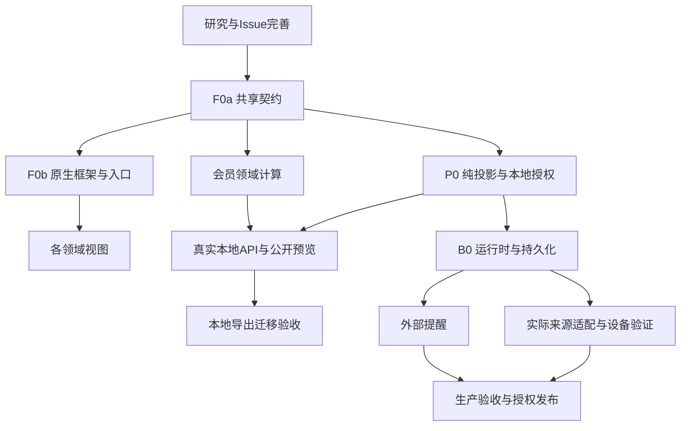

# 综合看板任务组织与开发顺序

2026-10-18。现有主链保持：内置应用 #9 → 综合看板 #36 → 会员 #27、个人 #37、自建服务/服务器 #32。idea仓库的 #4/#9 保留研究历史与实施链接，LifeOS承载实施验收。每个实现Issue保持单一职责，详细研究放评论。

**当前批次：** 用户将本次范围明确限定为 [纯前端演示](frontend.md)。先共享前端模型/fixture/控件，再并行实现五视图，最后OS接入与浏览器验收；后端、真实来源、持久化和通知只登记。以下长期任务与依赖继续保留，但本轮不执行P0服务端、B0或生产部署。不能确定的产品输入在完成前端后集中询问。

## 任务划分

| 任务 | 父任务 | 范围与接口所有者 | 前置条件 |
| --- | --- | --- | --- |
| F0 [原生应用框架与统一契约 #38](https://github.com/Hi-Yincan/LifeOS/issues/38) | #36 | Dashboard壳、DTO/error/capability、系统注册/路由/商店/语言/设置接入唯一写入者 | 本研究与规格 |
| P0 [隐私与公开投影 #39](https://github.com/Hi-Yincan/LifeOS/issues/39) | #36 | 时间/字段/聚合/预览/发布/撤回的唯一规则；政策版本 | F0先提交最小契约；引擎与本地服务不等待生产后台 |
| M0 会员 #27 | #36 | 权益/计划/付款/决定与确定性计算、原生会员视图 | F0；公开/API验收依赖P0 |
| S0 [服务目录与可用性 #41](https://github.com/Hi-Yincan/LifeOS/issues/41) | #32 | 目录、MonitorBinding、UptimeFlare首候选与条件化Kuma | F0/P0；目录可先用手动数据，实时接入依赖B0与来源 |
| H0 [服务器探针 #42](https://github.com/Hi-Yincan/LifeOS/issues/42) | #32 | 只读适配、单位/历史/断流、主机视图 | F0/P0；真实接入依赖B0及既有平台/主机清单 |
| A0 [活动/日程/位置 #43](https://github.com/Hi-Yincan/LifeOS/issues/43) | #37 | 手动状态、日程/轨迹导入与隐私精度 | F0/P0；持续采集依赖B0与设备/来源 |
| W0 [健康/检查 #44](https://github.com/Hi-Yincan/LifeOS/issues/44) | #37 | 指标/记录/附件、导入/来源修订/删除 | F0/P0；持续桥接依赖B0与设备权限 |
| B0 [常在线采集与持久化 #40](https://github.com/Hi-Yincan/LifeOS/issues/40) | #36 | 连接器执行、任务/仓储、游标/幂等/恢复、受限凭据 | F0/P0契约；生产运行另外依赖#12和实际资源决定 |
| N0 [事件与可靠提醒 #45](https://github.com/Hi-Yincan/LifeOS/issues/45) | #36 | 内部待办归一、外发任务/去重/结果；真实渠道另验 | M0/S0/H0事件语义；外发依赖B0和渠道 |

任务代码是计划中的稳定标识，数字编号已与GitHub原生父子关系关联；研究评论链接与回读验证记录于 [交接](../development/dashboard-research.md)。已有 #31 是独立进行的内容导出任务；看板共享导出/迁移在其已交付基线上对齐，不进入其工作树覆盖未提交代码。

## 消除依赖环

“共定契约”不是循环阻塞：F0a先固定最小领域类型、政策输入/输出、source envelope、错误和version语义；P0基于它实现纯投影/本地授权；B0再承载动态运行。P0的动态撤回验收依赖B0，但其纯逻辑与本地接口无需等待生产。会员App内待办也不等待外发通知。

## 第一开发批次建议

先串行完成F0a并由独立审查确认。再使用parallel-development新批次分配：原生框架/共享文件、P0规则与服务、会员领域计算/视图、目录领域/视图、接口/导出集成分别拥有明确目录与测试。共享的context/Settings/process目录/catalog/scripts只能由一个集成任务写，模块任务只依赖稳定契约。

本地首个可用流程建议是“会员建档→看清费用/权益→处理决定→确认结果→恢复”，同时完成服务目录。个人/主机模块提供正确来源配置状态和手动/格式路径，不以占位页面关闭对应Issue。真实采集、低频健康记录和各来源桥接继续按完整范围推进。

新增实施批次从本研究交付的已确认基线或经授权整合后的main建立；不继承旧批次lease，不在调研worktree直接堆入产品实现。每个写入者claim自己的任务，提交后由不同Agent审查；集成者只按已审查提交合入专用集成分支。用户要求先完善Issue，本批次不提前修改产品代码。

## 外部条件与继续工作的边界

| 待确认输入 | 阻止的工作 | 仍可进行 |
| --- | --- | --- |
| 穿戴/手机平台与版本、日历 | 实际授权、后台同步频率、来源解析范围 | schema、手动录入、合成导入、隐私引擎 |
| 已有服务/探针、私网范围 | 真实目标接入、安装/网络变化、容量结论 | provider固定协议样例、目录、公开字段/单位测试 |
| 策略/业务时区、币种、公开字段 | 真实个人数据发布与账期默认值 | 明确测试时区/币种的确定性算法；不假定作者设置 |
| 保留期、生产运行位置/资源 | 长期存储/备份与生产部署 | 隔离本地仓储/任务实现和恢复演练 |
| 通知渠道/真实收件人 | 外发测试与真实送达 | App内待办、隔离接收器、去重/失败/重试 |

技术选择可在已有授权内推进；不能因未知设备而改写已确认的统一App或OS风格，也不能以“需要数据”代替可自行完成的本地验证。提交、推送、合入main与发布遵循各自已有授权，本次Issue完善不等于生产发布授权。
