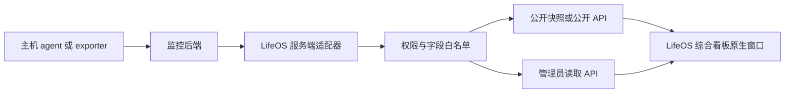

# 综合看板：服务器探针与指标聚合调研

核验日期：2026-10-18（UTC）。本文是综合看板研究批次的探针专题，供父 Issue 与实施 spec 使用；方案建议不代表已经部署或完成接入。LifeOS 基线为 `dba64cb0181bde7e8dc1f1610263d9a2c6983267`。

## 1. 结论与范围

服务器探针适合作为综合看板中的一个领域模块。LifeOS 自己负责原生窗口内的概览、筛选、主机详情、历史图与异常解释；成熟项目负责主机采集和时序存储。通过 LifeOS 服务端适配器读取所选后端，再统一字段、权限和新鲜度，可以复用监控能力并保持 OS 视觉一致。

建议按实际部署条件选择首个接入源：已有 Beszel、Komari、Nezha 或 Prometheus 时，先读取现有系统；没有既有部署时，先实现 Prometheus HTTP 查询契约的适配验证，因为它明确声明稳定的 `/api/v1` 查询接口。轻量个人服务器初装可以优先试验 Beszel，其用户级只读角色和默认历史梯度较适合本项目。最终部署选型仍需实际主机清单、现有监控栈和历史保留要求，不能为了网页展示直接安装多套 agent。[P1][B2][B4]

第一版建议覆盖主机列表、CPU、内存、文件系统容量、网络收发速率、最近采样时间、来源状态和按需历史。容器详情、GPU、SMART、进程清单、告警规则管理、WebSSH、远程命令和文件管理分别增加权限或运维责任，应作为后续独立范围；综合看板没有取得这些管理能力的默认授权。

探针领域回答“采集到的资源使用情况如何”。自建服务可用性回答“特定位置能否成功完成业务检查”。`agent online`、Prometheus `up=1`、主机 CPU 正常都不能证明应用登录、数据库查询或公网访问正常。主机与服务可以通过显式 `hostId`/`serviceIds` 关联，不能从相同 IP 或域名自动认定同一个业务对象。[P1][N2]

## 2. 研究方法与证据等级

本次实际执行了：读取 GitHub 官方仓库元数据、默认分支提交、最新非预发布 release 元数据；下载固定提交的 Beszel、Komari、Nezha 与两个独立 agent 源码进行静态核验；读取 Prometheus、node_exporter 官方源码和文档；核对 LifeOS 现有规范。Web 搜索已尝试但没有返回结果，随后通过 GitHub API 和官方源码完成核验。

没有启动或安装任何探针，没有连接用户真实服务器，没有向现有监控后台发请求，没有验证跨公网、NAT、TLS 反向代理或真实资源开销。下文的“源码已核验”证明相应实现存在，不等同于真实端到端测试通过；标为“建议”的字段、数值和验收是 LifeOS 的待实施设计。

下表的 SHA 是本次实际读取的默认分支快照，**不是 release 的承诺对应 SHA**。发行标签仅用于说明维护状况，实施时应另行固定已验证 release、镜像 digest、agent 版本和适配契约；不得用会移动的 `latest` 作为验收基线。提交时间与发布时间均为 UTC 日期。[B0][K0][N0][P0][G0][E0]

| 方案 | 固定源码 SHA | 快照提交日期 | API 返回的最新非预发布版本 / 发布时间 | 仓库声明许可 |
| --- | --- | --- | --- | --- |
| Beszel（hub、agent 同仓） | `e984ee12081f4e112601c3f718c9d81c112fe718` | 2026-10-17 | `v0.21.0` / 2026-10-02 | MIT |
| Komari（server） | `4b24f1e196b62a200606be95e6e434e5b95dff1f` | 2026-10-17 | `1.6.0` / 2026-10-16 | MIT |
| Nezha（dashboard） | `b329755836511da48d7b2af24968f275b0e41b32` | 2026-10-17 | `v2.3.18` / 2026-10-04 | Apache-2.0 |
| Prometheus | `c052a79dc7fd0f2df2219ffe336f510b0d149b72` | 2026-10-16 | `v3.15.0` / 2026-09-25 | Apache-2.0 |
| Grafana（组合中的可选运维界面） | `bcbfcbbaa3d503014391fed053923b1a94696916` | 2026-10-17 | `v13.2.4` / 2026-10-13 | AGPL-3.0 |
| node_exporter（Prometheus 的主机采集器） | `37ec35f6981b68c0d7c4191a802d8026064d1866` | 2026-10-15 | `v1.12.1` / 2026-07-14 | Apache-2.0 |

另核验 Komari agent `828afafe7fb5b1b58c1232094e1e46320719016e`（2026-09-23）和 Nezha agent `5030ee0f5e6683a0c791d9b8bf865e87f098d818`（2026-10-16）。这两个 agent 的实现与 dashboard 快照一起用于字段解释，尚未完成版本配对运行测试。[KA1][NA1]

许可列描述仓库实际声明，不构成引入依赖或复制源码的决定。当前建议是进程外读取 API、重新实现 LifeOS 原生界面；若以后复制源代码、图标、Grafana 面板或修改分发上游程序，必须记录具体文件来源并复核相应许可义务。不能把“参考开源项目”理解为可删除署名或忽略单独的插件、主题、图表依赖许可。

## 3. 四类代表方案比较

| 维度 | Beszel | Komari | Nezha | Prometheus + node_exporter + 可选 Grafana |
| --- | --- | --- | --- | --- |
| 适合参考的能力 | 紧凑主机/容器指标、用户授权、分层历史 | 多节点列表、实时上报、网络探测、指标定义/聚合 | 节点/服务联合观察、作用域 PAT、主机历史 | 明确指标类型、标签与查询 API、可配置抓取/保留 |
| 采集链路 | hub 连接 agent 的 SSH，或 agent 主动连 hub 的 WebSocket | agent 向 server 的 v2 RPC 上报，支持 HTTP/WS 入口 | agent 与 dashboard 的 gRPC 通道 | Prometheus 从 exporter 抓取 `/metrics` |
| LifeOS 读取入口 | PocketBase `systems`、`system_stats` 集合 | REST 兼容入口和 `/api/rpc2`；最新记录 WS | `/api/v1/server`、`/ws/server`、`/server/:id/metrics` | `/api/v1/query`、`/api/v1/query_range` |
| 接口稳定性判断 | 通用 PocketBase API 有固定形态，Beszel 业务 schema 仍需版本适配 | README 明确为前端面 RPC 内部架构，不能仅凭可调用就宣称稳定公共 API | 有版本前缀、路由与 scope；未找到永久兼容承诺，仍需固定版本 | 官方明确稳定 `/api/v1`；部分实验端点不在本项目接入范围 |
| 可用最小授权 | `readonly` 用户且只关联目标 systems；仍需代理限制路径 | API key 映射 admin，不应作为浏览器只读令牌 | PAT 限定 inventory/server read 与 server_ids；禁止通配权限 | 受保护网络及反向代理，只允许固定查询；exporter 对采集器开放 |
| 数据保留 | 已实现按类型删除与多级聚合 | 独立 metric store 与多级 rollup，当前分支变化较大 | 可选 TSDB，未启用时历史接口可能返回空集 | TSDB 保留时间/空间可控；查询步长不等于物理降采样 |
| 运维负担（结构判断） | hub 数据卷 + 各主机 agent + 认证/备份 | server 数据/指标库 + agent + 升级兼容测试 | dashboard 数据/可选 TSDB + agent + gRPC/反代与授权维护 | exporter + Prometheus 配置/存储；若保留 Grafana 另有配置/账户/备份 |
| 对 LifeOS 的取舍 | 轻量部署候选；不透传全部 collection | 已有部署可接；不为读取指标开启高权限 key 到前端 | 已有部署可接；当前版的 PAT/历史值得验证 | 推荐作为首个通用查询适配契约；Grafana 不进入 LifeOS 页面依赖 |

以上功能比较来自固定源码，性能开销没有实测，不能从“轻量”宣传直接给出 CPU、内存或主机数量承诺。[B1][B2][B3][B4][K1][K2][K3][K4][N1][N2][N3][N4][P1][P2][E1]

## 4. 每种方案的真实接入边界

### 4.1 Beszel

源码的 `internal/hub/collections.go` 在启动时设置 collection 规则。`systems` 读取要求已登录并关联该用户；`system_stats` 等系统从属数据通过 `system.users` 限制范围。设置 `SHARE_ALL_SYSTEMS=true` 会扩大已认证用户的读取范围，接入账户不应依赖该开关。`readonly` 会被禁止修改 systems 及部分系统资源，但仍允许操作自己的告警，且其他认证 GET 接口包含日志等信息；因此“readonly 用户”不能直接等同于 LifeOS 需要的最小字段/端点权限。[B2][B3]

可实施读取顺序：服务端以专用用户获取并续期 PocketBase 认证；请求 `GET /api/collections/systems/records`，按明确配置的系统 ID 取列表；请求 `GET /api/collections/system_stats/records`，由适配器生成系统 ID、时间和 `type` 筛选并分页。`stats` 使用缩短键名，如 `cpu`、`m`、`mu`、`d`、`du`、`b`；只在适配器内解析，不能作为 LifeOS 公开 schema。前端源码确实从 `system_stats` 读取历史，但本研究没有运行登录、过滤和分页请求，实施任务必须用固定版本补做契约测试。[B2][B5][B6]

主机 CPU 以全部 CPU 时间增量为分母，busy 排除 idle 和 iowait，并避免 Linux guest 时间重复计数；LXC/cgroup 路径可以按实际可用核数或配额归一。默认 hub 更新间隔为 60 秒，存在实时请求路径，不能在 UI 无条件标为“每秒实时”。网络 `b` 当前由计数器增量除以真实经过时间得到 bytes/s；旧缩短字段与新字段并存，不应只按变量英文名猜单位。内存/容量 `BytesToGigabytes` 实际除以 `2^30` 并保留两位，意味着是 GiB 且已损失精度；读写速率的同类转换为 MiB/s。[B5][B7]

历史删除规则：`1m` 留 1 小时、`10m` 留 12 小时、`20m` 留 24 小时、`120m` 留 7 天、`480m` 留 30 天。聚合平均/最大值不能当成每秒原始样本；请求较长时间窗时必须记录实际 `type` 和分辨率。[B4]

连接安全应按模式实施：SSH 模式配置 hub 公钥并限制入站来源；WebSocket 模式使用 `HUB_URL`、agent token，并验证 hub 签名对应的公钥；可用 `TOKEN_FILE` 和 `DISABLE_SSH`。不为综合看板直接开放 agent 端口到浏览器，也不自动挂载 Docker socket；容器统计需要额外授权和主机权限核验。[B1][B7]

### 4.2 Komari

当前源码的 REST 路由包括 `GET /api/nodes`、`GET /api/recent/:uuid`、`GET /api/records/load?uuid=...&load_type=...&hours=...`，并存在 `GET /api/clients` WebSocket（发送 `get` 或 `get <uuid>`）。RPC2 是 `GET/POST /api/rpc2`，公开方法有 `public:getNodesInformation`、`public:getClientRecentRecords`、`public:queryMetrics`、`public:listMetricDefinitions`。Agent 上报在另一条 `/api/clients/v2/rpc` 链路，LifeOS 不应把读取适配器写成模拟 agent 的上报客户端。[K1][K2]

`public:queryMetrics` 支持指标键、实体 ID、起止时间、最大点数和聚合算法，返回单位、`interval_seconds`、`downsampled`、算法和点集。它比只解析旧 REST 数组更适合统一历史；但目录 README 明确描述“前端面 RPC 内部架构”，且本次最新分支出现新的 store/rollup 路径。建议适配器记录 server 版本，先探测能力，对所支持版本做保存响应的契约测试；未知形状显式报不兼容，不静默换用另一个字段或旧接口。[K1][K3]

公开节点路径会按 hidden 过滤并清空 IPv4、IPv6、remark、agent version、token；私有站点的 Dispatch 对匿名调用另有检查。此裁剪不代表已符合 LifeOS 的公开规则，节点名、规格、地区与标签仍可能不应公开。API key 在当前 `IdentifyPrincipal` / `NewAPIKeyPrincipal` 实现中成为 admin，不能称其为只读 token。优先选择私网内受路径/方法限制的中间代理，或只读取上游已经明确公开的节点；私有数据接入若无法获得最小授权，应列为受限，不能把全权 key 嵌入静态构建。[K2][K5]

Agent 默认采集间隔 3 秒，CPU 使用 `cpu.Percent(0, false)` 的聚合结果；报文生成还把极低 CPU 值提升到 `0.001`，因此不能从该值推断“绝对有负载”。内存和磁盘为 bytes；网络 `up/down` 是 bytes/s，`totalUp/totalDown` 是计数器或按配置统计的周期流量。网络速率按实际时间差计算，首次采样和回退计数器有特殊处理。`month-rotate` 会改变累计流量含义，LifeOS 不应把它当统一的开机累计量。[KA1][KA2]

当前 metric store 默认 SQLite，并支持 MySQL/PostgreSQL；raw 精确窗口为 10 分钟，默认 1 分钟桶保留 600 分钟、5 分钟桶保留 3000 分钟、1 小时桶保留 600 小时，日桶为很长的保留配置。最终有效保留还受指标定义和运行配置影响，不能向用户承诺永久精确历史。返回的 `interval_seconds`、聚合算法和空点应一并进入适配结果。[K3][K4]

agent 的远程终端、任务执行和文件操作应按监控用途禁用：源码提供 `--disable-web-ssh`，默认值并非 true。令牌每个节点独立，关闭无需的自动更新/远程更新并明确版本升级流程；不调用管理员 `/api/admin/task/exec` 等路由。服务端连接存在 presence TTL 与 WebSocket 读超时，它们并不等于单条 CPU 指标的采样新鲜度。[KA1][KA3][K6]

### 4.3 Nezha

本次核验版本已包含作用域 PAT 与服务器 ID 白名单，不能依据旧版经验写成“只有全权 API key”或“只有 WebSocket”。当前 `/api/v1/server` 以及 `/api/v1/ws/server` 用 `nezha:inventory:read`；`/api/v1/server/:id/metrics` 与 online-history 用 `nezha:server:read`。建议专用 PAT 只授这两个读取 scope，明确 server_ids；不使用 `nezha:*`、exec、write、delete、transfer scope。服务器配置读取被划到敏感写权限，不能为了读取指标顺便获取配置。`server:read` 也复用于部分 MCP 读取能力，不能将它称为纯指标 token；代理与适配器仍须只允许明确的列表/指标路径，拒绝 `/mcp`、file、terminal 等无关入口。[N1][N2]

实时 WebSocket 返回主机状态、`last_active` 等，且会按访客、所有者与 PAT 范围过滤。`GET /api/v1/server/{id}/metrics?metric=cpu&period=1d` 是可落地历史入口；指标白名单含 cpu、memory、disk、network speed/transfer、load、uptime 等。`period` 仅支持 `1d/7d/30d`，访客仅允许 1d。这里的 `api/v1` 是路由名称，不能由此推断 dashboard 主版本为 v1，更不能推断兼容性永久稳定。[N2][N3]

TSDB 需要明确的 `DataPath` 才启用，默认保留 30 天，另有空间保护、缓存上限、30 秒去重间隔和写缓冲配置。TSDB 未启用时历史 handler 返回空 `data_points`，因此 LifeOS 要将“能力未启用”“时间窗无样本”“请求错误”分开。查询分辨率是 1d→30 秒、7d→30 分钟、30d→2 小时；聚合路径对普通值取均值、对某些累积值使用末值，不应把图上点标成原始瞬时值。[N3][N4]

Agent 用 aggregate CPU 百分比；内存、磁盘、累计网络均为整数 bytes，网络速率由计数差除以秒数得到。默认 `ReportDelay` 为 3 秒，合法配置为 1–4 秒；CPU采样、网络追踪和上报循环的窗口仍需运行验证。NIC 默认过滤若干虚拟接口并允许白名单，文件系统也有 allowlist。GPU 详细字段中某些内存单位是 MiB，与主机内存 bytes 不同，不能统一靠字段名 `memory_used` 判断。[NA1][NA2][N5]

部署链路使用 agent secret 与 UUID；应启用 TLS 校验，不开启 `InsecureTLS`。只观察资源时启用 `DisableCommandExecute`、`DisableNat`，按需要禁用向其他目标发起检查以及强制更新。PAT 仍只保留在 LifeOS 服务端，监控 agent 的注册密钥不应成为看板读取密钥。公共视图还需 LifeOS 自己对白名单字段投影，因为上游公开 Host 仍可含平台、CPU 型号、内存、架构与启动信息。[NA1][N2][N5]

### 4.4 Prometheus + Grafana

推荐读取 Prometheus 的稳定查询 API：`GET/POST /api/v1/query` 返回即时向量，`GET/POST /api/v1/query_range` 接受 `query/start/end/step` 并返回矩阵。响应包括 `status`、错误、warnings，样本值是字符串，应显式处理 `NaN`、`+Inf`、空向量和未知 resultType。LifeOS 的服务端选择固定查询模板与受控实例标签；浏览器不能传任意 PromQL、正则、超长时间窗或远程目标 URL。[P1]

Prometheus 数据源足以为 LifeOS 提供数值与历史，Grafana 只作为独立的高级运维入口候选。第一版不依赖 Grafana dashboard JSON、datasource proxy、截图或 iframe，也不加载 Grafana 的 UI/样式。这样无需把 Grafana 登录和面板布局带入 OS，且适配器接口只面向已声明稳定的指标查询。[P1][G0]

node_exporter 默认监听 9100，暴露主机指标；容器部署要正确设置 host namespace、rootfs 与挂载路径，否则可能采到容器视角。网络只允许 Prometheus 所在节点或专用采集网络访问，TLS/认证按 exporter web config 与代理落实；不把 `/metrics` 直接公开给访客。不同 OS 的 collector 支持不同，未采到某指标应报告 unsupported，而非零。[E1]

指标例子：`node_cpu_seconds_total` 是按 CPU、mode 累积的秒数；网络 receive/transmit bytes total 通过 `rate(...[5m])` 转为 bytes/s；filesystem size/free/avail 均是 bytes，avail 专指非 root 可用空间。CPU 公式必须说明 iowait 是否计入 busy。若要与 Beszel 默认 busy 对齐，建议按每核计算 idle+iowait 的 rate，再对逻辑 CPU 求平均，取 `100 * (1 - 平均空闲比例)`；实际选择的 mode、核数和窗口随结果记录。[E2][E3][P3]

默认 lookback 为 5 分钟，查询结果的时间戳是求值时刻，不一定是原始采集时刻；应额外查询采样时间/年龄或使用经验证的 recording rule 提供它。`up=0` 表示抓取失败，指标消失可能是 target 移除、collector 关闭或样本陈旧，不能都显示“服务器已关机”。`rate()`处理 counter reset，但仍需足够样本与窗口，不能从一个样本计算速率。[P3]

Prometheus 默认未设置保留时间和大小时保留 15 天；设置两个限制时先达到者生效。磁盘 block compaction 与图表查询的 `step` 都不代表业务上保存了粗粒度历史。长期降低存储成本应另行设计 recording rules/远端时序库与明确保留，第一版不建设另一套时序数据库。原生本地存储为单节点，需要监测容量和验证备份恢复，不承诺高可用。[P2]

## 5. LifeOS 的统一模型建议

以下为建议契约，不代表目前仓库已有这些字段或端点。上游 response 只存在服务端 adapter 内部，原始 payload 不进入公开内容种子、浏览器缓存或日志。

| 对象/字段 | 语义与约束 |
| --- | --- |
| `Host.id` / `providerRef` | LifeOS 稳定 ID 与私有上游映射分离；公开 ID 不使用 IP、agent UUID 或连接地址 |
| `displayName` / `visibility` | 双语显示名；默认私有，显式发布后才进入公共投影 |
| `provider` / `providerVersion` / `adapterVersion` | 私有诊断和兼容性依据；版本不匹配可以报 unsupported |
| `observedAt` / `receivedAt` / `generatedAt` | 原始采样、适配器接收、响应生成时刻分别保存，均为 UTC；无法获得 observedAt 时为空并说明限制 |
| `sampleWindowSeconds` / `resolutionSeconds` | 当前数值的统计窗口与历史返回分辨率分别保存；不能用 HTTP 轮询频率代替采样窗口 |
| `availability` | source online/offline/unknown；只表示来源明确提供或采集器能观察的连接状态 |
| `freshness` | fresh/stale/unknown；独立于 availability，计算基于最后有效样本 |
| `quality` | valid/missing/unsupported/invalid；首样本、除零、NaN、越界、counter reset 无法计算时都不能自动置零 |
| `cpu.percent` / `cpu.scope` / `cpu.denominator` | 0–100 的主机总占用与容器配额占用分开；记录 host/cgroup、逻辑 CPU 数或 quota 和 iowait 口径 |
| `memory.usedBytes/totalBytes/availableBytes` | bytes 为存储单位；`used` 的口径（是否排除 cache/可回收空间）保留，不擅自从所有 provider 统一重算 |
| `filesystems[]` | 内部保存 mount/device/source 去重标识，公开使用命名别名；capacity、used、available、inode、I/O 分为不同指标 |
| `network[]` | 指定接口集合，rx/tx bytes/s 与 cumulative bytes 分开；周期额度不是操作系统原生累计计数 |
| `history` | `start/end`、`resolutionSeconds`、`aggregation`、单位、点集、覆盖率；缺样为空；可用时保留 min/max/count |
| `serviceIds` | 显式关联自建服务对象；服务可用性与主机负载保持不同字段 |

CPU 不能把“4 核中 1 核满载”的 100% 单核口径与 25% 整机口径混画。容器 100% 的分母也可能是一个核或 quota，只有已验证同一分母才可合并；无法归一时保留来源原值与说明。[B7][KA1][NA2][E2]

容量展示使用 KiB/MiB/GiB 或明确的十进制 KB/MB/GB，网络默认 bytes/s，可由显示偏好换为 bit/s（乘 8）。例如 1,048,576 bytes/s 显示为 1 MiB/s 或约 8.39 Mbit/s；不能将两者都标“1 MB/s”。Beszel 已按 GiB 四舍五入的值转回 bytes 时应记录 precision，不能暗示字节级准确。[B7][K4]

文件系统不能简单把所有 mount 的 used 相加：同一底层设备、bind mount、overlay、tmpfs、ZFS dataset 可能重复或不同语义。第一版展示明确的根文件系统与用户选择的数据文件系统；容量百分比与读写 bytes/s 分开。`total=0`、无法读取、没有 swap 或权限不足分别显示缺失/不适用，不做除零。[B5][E1][E3]

## 6. 新鲜度、断流与历史策略

建议每个 adapter 声明实际采集间隔 `T`，无法获取则由受控配置提供并标注。首版候选规则为 `age > max(3T, 30s)` 标记 stale；该数值只是统一 UI 的实施起点，不是上游自带的失联阈值。记录了明确的 upstream offline 才显示“探针离线”；仅数据过期显示“数据陈旧”。连接超时、401、权限拒绝、接口变更、历史未启用分别给出可辨认的错误。

| 场景 | 建议 UI 与处理 |
| --- | --- |
| source 可达但 agent 不再上报 | 保留最后已知值与时间并加 stale；历史出现缺口，不能延续为当前值 |
| LifeOS 到 source 不可达 | 标 source error；不能宣称所有主机离线；保留受控时限的上次成功数据 |
| 浏览器切到后台、系统休眠后恢复 | 立即重新请求；过期缓存先显示 stale；不把本机暂停当作主机故障 |
| agent 重启、网络累计计数回退 | 重新建立基线；该段速率缺失，不能出现负数或无符号溢出的巨峰 |
| provider 返回 0 / null / 缺字段 | 只有确认的 0 才显示零；缺失不能通过 `value || 0` 消除 |
| provider 时间明显超前/倒退 | 显示时间异常并保留 receivedAt；不因为未来时间而永久 fresh |
| 一个图多条序列 | 使用各自采样时间和分辨率；缺点留空，不能对齐时伪造采样 |
| 数据源版本升级导致解析失败 | 保留上次成功记录并显示“不兼容”；记录脱敏字段/版本，不输出全 response |

第一版建议只缓存最新规范化快照，历史仍向 provider 按需查询。后端限制 `hostId × metric × timeRange × maxPoints`，候选上限为单图 600 点、同请求不超过 12 条序列；这些是待测的服务预算，不是上游能力上限。日后需要跨 provider 留存或离线期间追溯，再建立独立历史服务议题。

聚合时 gauge 的均值应按采样覆盖与窗口处理；不同宽度桶不能简单求平均的平均。保留 peak 与 count 才能解释“平均 20% 但出现过 100%”；只有上游平均值时不能反推出峰值。Counter 应先求合法增量/rate 再聚合，月重置流量不能与开机计数器直接相减；网络费用或服务商计费量需要单独账单来源。历史缺口不补零、不跨断流连线，也不把均值作为 SLA 可用率的分子。[B4][K3][K4][N4][P3]

## 7. 凭据、网络与公共投影

图中表示数据方向。Prometheus 抓取与 Beszel SSH 的实际连接可以由监控后端主动发起；不能由数据箭头推断防火墙入站规则。

1. 凭据分层：主机注册 secret、监控后台读取凭据、LifeOS 管理会话是三种身份。读取适配器只有必要读取能力；管理员浏览器也不接收上游 secret。凭据放服务端运行配置/密钥存储，通过不返回原值的更新接口管理，日志只记来源 ID、错误类别和时间。
2. 网络限制：只允许管理员预配置的来源 URL、协议、主机与端口；请求不得跟随到未授权目标，DNS/IP 检查和重定向检查一致；拒绝来自普通卡片字段的任意 URL。私网源需要明确允许的采集网段，不能一概开放本机、元数据地址或全部 RFC1918 段。
3. 请求限制：连接/总超时、响应体大小、并发、退避与熔断分别设限。401/403 停止自动高频重试并请求重新配置；WebSocket 用服务端一条受控连接缓存结果，不能每个访客各建一条管理后台连接。
4. 身份隔离：公共缓存与管理缓存分开，权限身份变化重新计算投影；公共缓存键不因某个管理员刚访问过而获得私有主机。动态受控服务收到新请求时，按当前发布策略过滤列表，并拒绝通过旧 hostId 读取已撤销的详情与历史；撤销同时失效受控缓存。多节点、代理和 CDN 的撤销传播必须记录并验收明确的最长生效时间，不能承诺已经交付给客户端的数据会被收回。
5. Agent 只做监控所需操作：不为这项功能打开 WebSSH、RCE、NAT 或文件管理。Docker socket 的 `:ro` 挂载不应被当作对 Docker API 的只读授权；若后续需要容器指标，应单列最小权限方案并验收。

建议默认所有主机与原始指标私有。公开白名单是逐主机、逐指标的 opt-in：`publicId`、双语别名、粗粒度地区（如作者选择）、公开状态说明、允许的资源摘要、生成时间与数据陈旧说明。默认不公开 IP、域名/内网地址、SSH 端口、agent UUID、上游 ID、token、原始 hostname、CPU 序列信息、mount/device 路径、容器/进程名称、连接数、软件版本、购买渠道与账单、管理 URL、标签和私有备注。字段来自上游的“public”接口也要重新投影。

当前生产是 Pages 静态访客版，不能承担私有来源代理或保存读取凭据。可交付的静态模式只有经过明确公开授权的、带 `generatedAt` 的快照；页面应写“截至某时的快照”，不能显示伪实时在线灯。真正实时的公开展示依赖受限公共读取服务以及生产服务/存储议题完成，不能通过在前端添加 CORS header 或放入 API key 绕开。[L1][L2]

静态快照撤销后，下一次构建与发布应从新产物中移除对应主机和数据，并核验新发布的列表、详情与历史文件；该动作不能保证收回 Git 历史、旧发布 URL、CDN 缓存或访客已经下载的副本。需要自动撤销或到期后强制停止读取的敏感数据，不得由公开静态文件承载。`expiresAt`、前端隐藏和客户端缓存清理只表达显示或新鲜度行为，不构成服务端授权检查，也不能使已公开的文件失去可复制性。

## 8. LifeOS UI 参考与不搬用的部分

沿用 daedalOS 的进程、窗口、主题、工具栏、地址栏、状态栏、滚动条与当前 Surface。顶部提供“概览 / 主机 / 服务”等业务视图入口时使用已有紧凑控件；主机列表展示公开别名、状态、CPU/内存摘要与采样时间，详情再按需加载历史。视窗缩窄时自然换行和滚动，不另造手机监控外壳。[L3]

可以参考 Beszel 的“列表进入详情”、Komari/Nezha 的节点与网络指标组合、Grafana 的时间范围和图例语义；不要直接嵌入第三方前端、复制高饱和装饰卡片或引入第二套主题。图上明确单位、统计窗口、聚合方式与缺口；状态用文字与标记共同表达，键盘能进入主机详情和时间选择，中英文包括 empty/loading/stale/error/unsupported。

监控来源配置归入现有系统设置的管理入口；普通综合看板窗口不增加默认设置按钮。已有管理会话只影响 LifeOS 数据读取权限，不自动赋予用户第三方监控系统的管理员身份。[L3]

## 9. Issue 拆分与可实施验收建议

探针领域应有独立子 Issue，并由综合看板父 Issue 关联，避免把主机监控、会员到期、个人健康和服务可用性写进同一个实现任务。建议按以下可观察交付拆分，Issue 编号由协调者创建/关联，本文不假造编号。

| 子任务 | 交付与依赖 | 完成验收 |
| --- | --- | --- |
| 领域模型与公开策略 | 定义 Host/Metric/Freshness、单位和权限，依赖综合看板共用模型 | schema 拒绝非法单位/日期；新主机默认私有；public DTO 的精确键集合有测试 |
| 首个只读 adapter | 选定实际来源版本与凭据方式，依赖主机清单和后端读取能力 | 对固定部署执行认证、列表、最新值和历史请求；记录原始时间语义；401/403/timeout/schema change 有真实证据 |
| 原生主机视图 | 列表、详情、历史与状态，依赖规范化 API | 中英文、键盘、窗口缩放、空/错误/陈旧/不支持均可辨认；不改变原生窗口行为 |
| 采样语义与历史 | 单位转换、counter reset、间隔/聚合/缺口 | 4 核/单核口径夹具、bytes↔bits、GiB 精度、重启断流、跨粒度历史不产生假峰/补零 |
| 公共快照导出 | 公共字段/主机明确发布，依赖现有公开导出链路 | 导出产物与网络响应不含 private 字段/凭据；下架后下一次构建/发布移除新产物中的列表、详情及历史数据；记录 Git、旧 URL、CDN 与已下载副本无法保证收回的边界；不导出需要自动撤销的敏感数据 |
| 生产来源接入 | TLS、凭据轮换、隔离、备份、恢复，依赖生产服务议题与明确操作授权 | 限定地址/端点/主机可读；越权拒绝；动态新请求按当前发布策略过滤列表并拒绝已撤销旧 ID 的详情/历史，失效受控缓存并记录撤销传播上限；轮换后旧凭据失效；恢复演练与线上数据新鲜度有证据 |

核心行为测试建议：

- 合成时序包含真实零值、缺字段、null、NaN、未来时间、过期时间、counter reset、低于两样本和单位变化；这些属于解析/计算单元测试，不能作为真实监控接入验收。
- 使用隔离的固定版本真实后端与合成节点验证成功和失败响应，检查只有 read scope 的凭据不能执行命令、写配置、读私有配置或访问白名单外主机。没有隔离环境时保持该项未执行，不用 mock 成功替代。
- 断开 agent、断开 LifeOS→source、停止采样但保留连接三种情况分别验证；前两种不能被展示成同一个错误。
- 并发管理员/访客、退出管理会话、公开→私有、来源删除及缓存过期时检查动态服务的新请求与受控缓存，测量撤销传播上限；静态模式另行检查下一次发布产物确实移除，不以删除既有副本作为可保证的验收。浏览器 bundle、source map、静态导出 JSON、请求 URL、错误日志都不能含上游秘密。
- 接入数据库/持久化之前确定快照可恢复和权限撤销策略；来源升级先跑保存的契约样本再对隔离真实后端复测。
- 性能验收记录真实主机数、系列数、采样间隔、查询窗、返回字节、adapter 响应时间和前端绘图耗时；本报告没有给出未经测量的容量保证。

## 10. 待确认业务输入与研究边界

实施来源接入前必须知道：现有使用的是哪种监控栈与版本、计划纳入哪些主机、是否包含家用内网设备、哪些主机/指标可以公开、需要分钟级概览还是秒级诊断、历史需要多久、是否保留独立监控后台。以上不能通过读取用户机器上的私有运行配置推断，也不能从“服务器探针看板”推断允许安装 agent、开放端口或购买服务。

这些输入不阻碍现在编写领域模型、空状态、标准化 schema、合成数据的语义测试与原生视图；真实来源适配和生产运维应把未确认点写入依赖，不制造假的个人服务器列表。GPU/容器/SMART、跨地域延迟、告警通知、服务商账单与远程管理明确留到各自范围。

本报告只完成公开资料和固定源码调研。所列接口能从源码定位，但尚未以匹配版本的真实服务验证；当前主分支快照可能包含最新 release 尚未包含的能力，特别是 Komari RPC/metric store 与 Nezha PAT/TSDB。发布选型必须逐项核对目标版本，不把这份快照比较直接当成可升级生产的依据。

## 11. 一手来源索引

链接中的源码 SHA 均为本次实际核验版本。维护元数据读取的是 GitHub API `repos/{owner}/{repo}`、`commits/HEAD`、`releases/latest`，上表记录本次返回值；以下 release 链接固定到当次标签。项目 README 的功能声明与本文的源码核验、建议范围分别标明。

| 版本与许可记录 | 一手来源 |
| --- | --- |
| Beszel | [v0.21.0](https://github.com/henrygd/beszel/releases/tag/v0.21.0) · [LICENSE](https://github.com/henrygd/beszel/blob/e984ee12081f4e112601c3f718c9d81c112fe718/LICENSE) |
| Komari | [1.6.0](https://github.com/komari-monitor/komari/releases/tag/1.6.0) · [LICENSE](https://github.com/komari-monitor/komari/blob/4b24f1e196b62a200606be95e6e434e5b95dff1f/LICENSE) |
| Nezha | [v2.3.18](https://github.com/nezhahq/nezha/releases/tag/v2.3.18) · [LICENSE](https://github.com/nezhahq/nezha/blob/b329755836511da48d7b2af24968f275b0e41b32/LICENSE) |
| Prometheus | [v3.15.0](https://github.com/prometheus/prometheus/releases/tag/v3.15.0) · [LICENSE](https://github.com/prometheus/prometheus/blob/c052a79dc7fd0f2df2219ffe336f510b0d149b72/LICENSE) |
| Grafana | [v13.2.4](https://github.com/grafana/grafana/releases/tag/v13.2.4) · [LICENSE][G0] |
| node_exporter | [v1.12.1](https://github.com/prometheus/node_exporter/releases/tag/v1.12.1) · [LICENSE](https://github.com/prometheus/node_exporter/blob/37ec35f6981b68c0d7c4191a802d8026064d1866/LICENSE) |

[B0]: https://github.com/henrygd/beszel/commit/e984ee12081f4e112601c3f718c9d81c112fe718
[B1]: https://github.com/henrygd/beszel/blob/e984ee12081f4e112601c3f718c9d81c112fe718/README.md
[B2]: https://github.com/henrygd/beszel/blob/e984ee12081f4e112601c3f718c9d81c112fe718/internal/hub/collections.go
[B3]: https://github.com/henrygd/beszel/blob/e984ee12081f4e112601c3f718c9d81c112fe718/internal/hub/api.go
[B4]: https://github.com/henrygd/beszel/tree/e984ee12081f4e112601c3f718c9d81c112fe718/internal/records
[B5]: https://github.com/henrygd/beszel/blob/e984ee12081f4e112601c3f718c9d81c112fe718/internal/entities/system/system.go
[B6]: https://github.com/henrygd/beszel/blob/e984ee12081f4e112601c3f718c9d81c112fe718/internal/site/src/components/routes/system/use-system-data.ts
[B7]: https://github.com/henrygd/beszel/tree/e984ee12081f4e112601c3f718c9d81c112fe718/agent
[K0]: https://github.com/komari-monitor/komari/commit/4b24f1e196b62a200606be95e6e434e5b95dff1f
[K1]: https://github.com/komari-monitor/komari/blob/4b24f1e196b62a200606be95e6e434e5b95dff1f/web/rpc/jsonrpc/README.md
[K2]: https://github.com/komari-monitor/komari/blob/4b24f1e196b62a200606be95e6e434e5b95dff1f/web/router/router.go
[K3]: https://github.com/komari-monitor/komari/blob/4b24f1e196b62a200606be95e6e434e5b95dff1f/web/rpc/jsonrpc/public.metric.go
[K4]: https://github.com/komari-monitor/komari/tree/4b24f1e196b62a200606be95e6e434e5b95dff1f/internal/metricstore
[K5]: https://github.com/komari-monitor/komari/blob/4b24f1e196b62a200606be95e6e434e5b95dff1f/pkg/rpc/principal.go
[K6]: https://github.com/komari-monitor/komari/blob/4b24f1e196b62a200606be95e6e434e5b95dff1f/web/agent/connections.go
[KA1]: https://github.com/komari-monitor/komari-agent/tree/828afafe7fb5b1b58c1232094e1e46320719016e/monitoring
[KA2]: https://github.com/komari-monitor/komari-agent/blob/828afafe7fb5b1b58c1232094e1e46320719016e/readme.md
[KA3]: https://github.com/komari-monitor/komari-agent/blob/828afafe7fb5b1b58c1232094e1e46320719016e/cmd/root.go
[N0]: https://github.com/nezhahq/nezha/commit/b329755836511da48d7b2af24968f275b0e41b32
[N1]: https://github.com/nezhahq/nezha/blob/b329755836511da48d7b2af24968f275b0e41b32/model/api_token.go
[N2]: https://github.com/nezhahq/nezha/tree/b329755836511da48d7b2af24968f275b0e41b32/cmd/dashboard/controller
[N3]: https://github.com/nezhahq/nezha/blob/b329755836511da48d7b2af24968f275b0e41b32/cmd/dashboard/controller/server.go
[N4]: https://github.com/nezhahq/nezha/tree/b329755836511da48d7b2af24968f275b0e41b32/pkg/tsdb
[N5]: https://github.com/nezhahq/nezha/blob/b329755836511da48d7b2af24968f275b0e41b32/model/host.go
[NA1]: https://github.com/nezhahq/agent/blob/5030ee0f5e6683a0c791d9b8bf865e87f098d818/model/config.go
[NA2]: https://github.com/nezhahq/agent/tree/5030ee0f5e6683a0c791d9b8bf865e87f098d818/pkg/monitor
[P0]: https://github.com/prometheus/prometheus/commit/c052a79dc7fd0f2df2219ffe336f510b0d149b72
[P1]: https://github.com/prometheus/prometheus/blob/c052a79dc7fd0f2df2219ffe336f510b0d149b72/docs/querying/api.md
[P2]: https://github.com/prometheus/prometheus/blob/c052a79dc7fd0f2df2219ffe336f510b0d149b72/docs/storage.md
[P3]: https://github.com/prometheus/prometheus/tree/c052a79dc7fd0f2df2219ffe336f510b0d149b72/docs/querying
[G0]: https://github.com/grafana/grafana/blob/bcbfcbbaa3d503014391fed053923b1a94696916/LICENSE
[E0]: https://github.com/prometheus/node_exporter/commit/37ec35f6981b68c0d7c4191a802d8026064d1866
[E1]: https://github.com/prometheus/node_exporter/blob/37ec35f6981b68c0d7c4191a802d8026064d1866/README.md
[E2]: https://github.com/prometheus/node_exporter/blob/37ec35f6981b68c0d7c4191a802d8026064d1866/collector/cpu_linux.go
[E3]: https://github.com/prometheus/node_exporter/blob/37ec35f6981b68c0d7c4191a802d8026064d1866/collector/filesystem_common.go
[L1]: ../../deployment/pages.md
[L2]: ../../concept/data-and-permissions.md
[L3]: ../../concept/design-system.md
